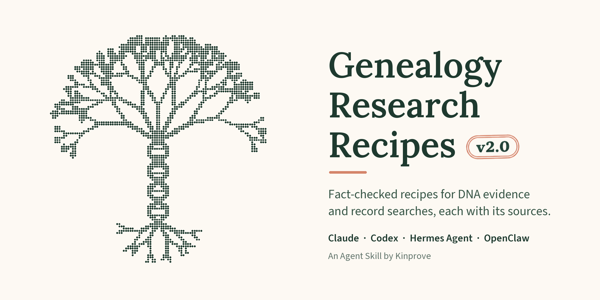

# Genealogy Research Recipes

One skill instead of many: DNA evidence and record searches across countries, archives and
testing companies, in one catalog that grows with every release. Each recipe lists its sources. The
[provenance report](https://github.com/Kinprove/genealogy-research-recipes/blob/main/PROVENANCE.md)
shows which source records have been reviewed and which are still pending.

It is one [Agent Skill](https://code.claude.com/docs/en/skills) for Claude, Codex, Hermes Agent
and OpenClaw, by [Kinprove](https://kinprove.io). It needs no Kinprove account or API key, registers
no tools or hooks, and makes no network calls of its own. To set it up, see [Install](#install).

## Recipes

### Research method

- **Evidence and proof:** [evidence, proof and working hypotheses](skills/genealogy-research-recipes/recipes/evidence-proof-judgment.md), [standards audits](skills/genealogy-research-recipes/recipes/genealogy-standards-audit.md), [source citations](skills/genealogy-research-recipes/recipes/source-citation.md), [research logs and reports](skills/genealogy-research-recipes/recipes/research-documentation.md), [Test what a Finnish commemorative plaque identifies](skills/genealogy-research-recipes/recipes/finnish-commemorative-plaque-evidence.md), [Trace a coat of arms to its bearer before testing descent](skills/genealogy-research-recipes/recipes/heraldic-arms-bearer-recovery.md)
- **AI and long projects:** [long projects with an AI agent](skills/genealogy-research-recipes/recipes/agent-research-project.md), [AI for documents](skills/genealogy-research-recipes/recipes/ai-for-documentary-records.md)
- **Search coverage and name searches:** [archival images and search coverage](skills/genealogy-research-recipes/recipes/archival-image-coverage-verification.md), [corpus-seeded name searches](skills/genealogy-research-recipes/recipes/corpus-seeded-name-search.md), [surname-distribution leads](skills/genealogy-research-recipes/recipes/surname-distribution-locality-leads.md), [women's maiden names](skills/genealogy-research-recipes/recipes/maiden-name-recovery.md)
- **Family trees and research planning:** [RootsMagic reconciliation](skills/genealogy-research-recipes/recipes/rootsmagic-tree-reconciliation-workflow.md), [Family Tree Maker](skills/genealogy-research-recipes/recipes/ftm-research-workflows.md), [WikiTree DNA tester links](skills/genealogy-research-recipes/recipes/wikitree-dna-tester-links.md), [GEDCOM export of research findings](skills/genealogy-research-recipes/recipes/gedcom-research-export.md), [descendancy gap worklists](skills/genealogy-research-recipes/recipes/descendancy-gap-worklist.md), [genealogical numbering systems](skills/genealogy-research-recipes/recipes/genealogical-numbering-systems.md), [Ancestry Pro Tools tree worklists](skills/genealogy-research-recipes/recipes/ancestry-pro-tools-tree-worklists.md), [cousin relationships across pedigree paths](skills/genealogy-research-recipes/recipes/cousin-relationship-paths.md), [MyHeritage profile hints](skills/genealogy-research-recipes/recipes/myheritage-profile-hint-extraction.md), [MyHeritage Country Coding](skills/genealogy-research-recipes/recipes/myheritage-country-coding-place-audit.md), [Audit a MyHeritage AI Biography through its contributing sources](skills/genealogy-research-recipes/recipes/myheritage-ai-biography-source-audit.md), [Audit MyHeritage Cousin Finder relationships against both trees](skills/genealogy-research-recipes/recipes/myheritage-cousin-finder-audit.md), [Turn MyHeritage Family Statistics charts into tree audit worklists](skills/genealogy-research-recipes/recipes/myheritage-family-statistics-worklists.md), [Manage biological, adoptive and foster parents in MyHeritage](skills/genealogy-research-recipes/recipes/myheritage-online-parent-relationships.md), [Audit a MyHeritage tree with consistency checks, timelines and maps](skills/genealogy-research-recipes/recipes/myheritage-tree-event-and-place-audit.md)

### DNA

- **DNA reasoning:** [unknown parentage and WATO](skills/genealogy-research-recipes/recipes/unknown-parentage-wato.md), [AI for DNA research](skills/genealogy-research-recipes/recipes/ai-for-dna-research.md), [Y-DNA and mtDNA](skills/genealogy-research-recipes/recipes/ydna-mtdna-interpretation.md), [X-DNA and phasing](skills/genealogy-research-recipes/recipes/xdna-phasing-judgment.md), [cross-vendor DNA comparisons](skills/genealogy-research-recipes/recipes/dna-comparison-controls.md)
- **DNA testing sites and tools:** [23andMe](skills/genealogy-research-recipes/recipes/23andme-match-research.md), [AncestryDNA](skills/genealogy-research-recipes/recipes/ancestry-dna-match-investigation.md), [FamilyTreeDNA exports and Group Time Tree](skills/genealogy-research-recipes/recipes/ftdna-practical-dna-workflows.md), [GEDmatch](skills/genealogy-research-recipes/recipes/gedmatch-practical-dna-workflows.md), [MyHeritage DNA](skills/genealogy-research-recipes/recipes/myheritage-dna-match-investigation.md), [DNA Painter](skills/genealogy-research-recipes/recipes/dnapainter-practical-dna-workflows.md), [MyHeritage DNA processing and downloads](skills/genealogy-research-recipes/recipes/myheritage-kit-processing-and-downloads.md), [Test a complex pedigree in BanyanDNA](skills/genealogy-research-recipes/recipes/banyandna-complex-pedigree-analysis.md)
- **Ethnicity, admixture and match outreach:** [reading an ethnicity estimate](skills/genealogy-research-recipes/recipes/interpreting-ancestry-composition-estimates.md), [admixture run scope](skills/genealogy-research-recipes/recipes/admixture-model-run-scope.md), [ethnicity-estimate versions](skills/genealogy-research-recipes/recipes/ethnicity-estimate-version-comparison.md), [DNA match outreach](skills/genealogy-research-recipes/recipes/dna-match-outreach-staging.md)

### Record websites, libraries and maps

- **Record websites:** [Ancestry](skills/genealogy-research-recipes/recipes/ancestry-record-search-recovery.md), [FamilySearch](skills/genealogy-research-recipes/recipes/familysearch-practical-record-workflows.md), [MyHeritage](skills/genealogy-research-recipes/recipes/myheritage-historical-record-search.md), [Newspapers.com title, issue and notice recovery](skills/genealogy-research-recipes/recipes/newspapers-com-search-recovery.md), [Geni](skills/genealogy-research-recipes/recipes/geni-practical-research-workflows.md), [Find a Grave memorial corrections](skills/genealogy-research-recipes/recipes/find-a-grave-memorial-corrections.md), [Newspaper Finder for title and issue coverage](skills/genealogy-research-recipes/recipes/newspaper-finder-title-coverage.md), [U.S. National Archives finding aids and microfilm](skills/genealogy-research-recipes/recipes/us-national-archives-finding-aids-and-microfilm.md), [FamilySearch Research Wiki locality routing](skills/genealogy-research-recipes/recipes/familysearch-research-wiki-locality-routing.md), [RootsTech sessions and handouts](skills/genealogy-research-recipes/recipes/rootstech-on-demand-session-recovery.md), [Recover broken RootsWeb links](skills/genealogy-research-recipes/recipes/rootsweb-broken-link-recovery.md), [Search historical newspapers with Elephind](skills/genealogy-research-recipes/recipes/elephind-historical-newspaper-search.md), [Find and verify a French historical record in Filae](skills/genealogy-research-recipes/recipes/filae-historical-record-search.md), [Find Finnish archival material in Astia by creator and record type](skills/genealogy-research-recipes/recipes/finland-astia-creator-and-material-search.md), [Recover a Finnish archival unit in Astia](skills/genealogy-research-recipes/recipes/finnish-astia-archival-unit-recovery.md), [Recover a dated version of a Finnish online news article](skills/genealogy-research-recipes/recipes/finnish-online-news-version-recovery.md), [Review a MyHeritage GAIA investigation and its evidence](skills/genealogy-research-recipes/recipes/myheritage-gaia-research-review.md)
- **Books, periodicals and manuscripts:** [published books](skills/genealogy-research-recipes/recipes/published-book-catalogue-and-full-text-discovery.md), [periodical indexes](skills/genealogy-research-recipes/recipes/periodical-index-search-retrieval.md), [manuscripts, ledgers and fraternal claim folders](skills/genealogy-research-recipes/recipes/manuscript-collection-recovery.md), [uncatalogued local holdings](skills/genealogy-research-recipes/recipes/local-repository-uncatalogued-holdings.md), [historical newspaper sections](skills/genealogy-research-recipes/recipes/historical-newspaper-section-search.md), [historical Olympic participants](skills/genealogy-research-recipes/recipes/olympic-participation-records.md), [SlaveVoyages person and voyage linkage](skills/genealogy-research-recipes/recipes/slavevoyages-person-and-voyage-linkage.md), [1926 Slavery Convention implementation records](skills/genealogy-research-recipes/recipes/slavery-convention-territorial-record-recovery.md), [Find historical Finnish newspaper coverage across languages and issue gaps](skills/genealogy-research-recipes/recipes/finnish-historical-newspaper-issue-recovery.md), [Attribute a historical Finnish newspaper byline](skills/genealogy-research-recipes/recipes/finnish-newspaper-byline-attribution.md), [Trace a Finnish newspaper correspondent across signatures](skills/genealogy-research-recipes/recipes/finnish-newspaper-correspondent-recovery.md), [Recover Finnish newspaper local letters in Translocalis](skills/genealogy-research-recipes/recipes/finnish-translocalis-local-letter-recovery.md), [Reconstruct Finnish historical newspaper serials and reprints](skills/genealogy-research-recipes/recipes/finnish-newspaper-serial-recovery.md), [Identify a pseudonymous writer in Finnish historical periodicals](skills/genealogy-research-recipes/recipes/finnish-pseudonymous-author-recovery.md), [Recover an early Posttidningar issue across copies](skills/genealogy-research-recipes/recipes/posttidningar-issue-recovery.md), [Recover related issues and editions of a historical Finnish newspaper item](skills/genealogy-research-recipes/recipes/finnish-newspaper-reprints-and-serials.md)
- **Places and maps:** [historical place names](skills/genealogy-research-recipes/recipes/historical-place-name-resolution.md), [historical maps and possible originating cases](skills/genealogy-research-recipes/recipes/historical-map-record-recovery.md)

### Records by country and region

- **Central and Eastern Europe by period state:** [Galicia and Bukovina by confession and custodian](skills/genealogy-research-recipes/recipes/galicia-bukovina-habsburg-record-routing.md), [Bessarabia and Moldova by period and district](skills/genealogy-research-recipes/recipes/bessarabia-moldova-record-routing.md), [historic Hungary](skills/genealogy-research-recipes/recipes/historic-hungary-record-routing.md), [Austria and the Czech lands](skills/genealogy-research-recipes/recipes/austrian-confessional-register-routing.md), [Polish originals](skills/genealogy-research-recipes/recipes/polish-index-original-record-recovery.md), [Polish parish and civil registration](skills/genealogy-research-recipes/recipes/polish-parish-and-civil-register-routing.md), [Find Romanian Chamber of Labour personnel files](skills/genealogy-research-recipes/recipes/romanian-chamber-of-labour-personnel-files.md), [Trace Białystok households through the 1831 cholera committee papers](skills/genealogy-research-recipes/recipes/bialystok-cholera-committee-record-recovery.md), [Use the Cmolas estate inventory to test family links](skills/genealogy-research-recipes/recipes/cmolas-estate-inventory-recovery.md), [Recover a Czech holding’s corvée obligation](skills/genealogy-research-recipes/recipes/czech-estate-corvee-record-recovery.md), [Find and read historical Czech census schedules](skills/genealogy-research-recipes/recipes/czech-historical-census-recovery.md), [Trace a historical Czech criminal case through newspapers](skills/genealogy-research-recipes/recipes/czech-newspaper-criminal-case-recovery.md), [Read a Czech parish death or burial narrative](skills/genealogy-research-recipes/recipes/czech-parish-death-entry-reading.md), [Distinguish Estonian farm bynames from inherited family names](skills/genealogy-research-recipes/recipes/estonian-byname-and-surname-recovery.md), [Trace an Estonian household across surname assignment](skills/genealogy-research-recipes/recipes/estonian-surname-and-household-recovery.md), [Find the civil register for a historical Ilfov locality](skills/genealogy-research-recipes/recipes/ilfov-civil-register-recovery.md), [Find Mehedinți civil registers by locality, event and year](skills/genealogy-research-recipes/recipes/mehedinti-civil-register-recovery.md), [Read the 1824–1825 Moldavian foreign-protection register](skills/genealogy-research-recipes/recipes/moldavian-foreign-protection-register.md), [Recover Polish district-commission questionnaires on Nazi occupation crimes](skills/genealogy-research-recipes/recipes/polish-district-commission-questionnaires.md), [Recover peasant land and settlement files for Radom Governorate](skills/genealogy-research-recipes/recipes/radom-peasant-land-record-recovery.md), [Trace Riga’s Swedish–Finnish parish at St James’s](skills/genealogy-research-recipes/recipes/riga-swedish-finnish-parish-recovery.md), [Find Romanian historical civil registers by locality and year](skills/genealogy-research-recipes/recipes/romanian-eanr-civil-register-recovery.md), [Find a household in Romania’s 1930, 1941 or 1948 census](skills/genealogy-research-recipes/recipes/romanian-historical-census-household-recovery.md)
- **Russian Empire and Soviet Union:** [Orthodox metrical books](skills/genealogy-research-recipes/recipes/russian-orthodox-metrical-book-recovery.md), [Jewish metrical books and rabbinates](skills/genealogy-research-recipes/recipes/russian-empire-jewish-metrical-book-recovery.md), [revision-list households](skills/genealogy-research-recipes/recipes/russian-revision-list-household-chaining.md), [Orthodox confession lists](skills/genealogy-research-recipes/recipes/russian-orthodox-confession-list-reading.md), [auditing confession-list and revision-list transcriptions](skills/genealogy-research-recipes/recipes/russian-household-list-transcription-audit.md), [village families when a generation's records are missing](skills/genealogy-research-recipes/recipes/russian-village-family-reconstitution.md), [Muscovite census and settler origins](skills/genealogy-research-recipes/recipes/muscovite-census-settler-origin-recovery.md), [estate registration status](skills/genealogy-research-recipes/recipes/russian-estate-registration-status.md), [volost and town administrations](skills/genealogy-research-recipes/recipes/russian-volost-town-administration-records.md), [Old Believers](skills/genealogy-research-recipes/recipes/old-believer-sectarian-record-recovery.md), [Orthodox clergy](skills/genealogy-research-recipes/recipes/orthodox-clergy-record-recovery.md), [imperial service lists](skills/genealogy-research-recipes/recipes/russian-imperial-service-record-recovery.md), [schools and universities](skills/genealogy-research-recipes/recipes/school-university-record-recovery.md), [emigrant origins](skills/genealogy-research-recipes/recipes/russian-empire-emigrant-origin-recovery.md), [Soviet personal files](skills/genealogy-research-recipes/recipes/soviet-personal-file-recovery.md), [Russian military and Soviet-repression records](skills/genealogy-research-recipes/recipes/russian-military-repression-record-episodes.md), [the 1944 Chechen and Ingush deportation](skills/genealogy-research-recipes/recipes/chechen-ingush-1944-deportation-records.md), [Trace a Finn in Russia or the Soviet Union through Kohtalona Neuvostoliitto](skills/genealogy-research-recipes/recipes/kohtalona-neuvostoliitto-record-recovery.md)
- **Jewish records:** [name and registration changes](skills/genealogy-research-recipes/recipes/russian-empire-jewish-identity-attribution.md), [conditional naming, town and DNA clues](skills/genealogy-research-recipes/recipes/jewish-genealogy-conditional-hypotheses.md), [JewishGen](skills/genealogy-research-recipes/recipes/jewishgen-search-family-reconstruction.md), [Beider given names](skills/genealogy-research-recipes/recipes/beider-given-name-variants.md), [HebrewBooks](skills/genealogy-research-recipes/recipes/hebrewbooks-search-recovery.md), [rabbinic and Hasidic literature](skills/genealogy-research-recipes/recipes/rabbinic-literature-person-search.md), [Holocaust testimony and survivor sources](skills/genealogy-research-recipes/recipes/holocaust-testimony-source-interpretation.md), [Israel immigration lists](skills/genealogy-research-recipes/recipes/israel-immigration-list-research.md), [Lithuanian-Jewish household registers](skills/genealogy-research-recipes/recipes/lithuanian-jewish-household-registers.md), [Holocaust registers and survivor lists](skills/genealogy-research-recipes/recipes/holocaust-register-and-survivor-list-recovery.md), [Trace a prisoner’s confiscated personal effects through the Arolsen Archives](skills/genealogy-research-recipes/recipes/arolsen-confiscated-effects-recovery.md)
- **Ukrainian archives:** [Jewish named-list triage](skills/genealogy-research-recipes/recipes/jewish-archival-list-triage.md), [ELIB archival guides and volume identity](skills/genealogy-research-recipes/recipes/elib-ukrainian-archive-reference-books.md), [Trace a Nizhyn Greek family through the Greek Magistrate records](skills/genealogy-research-recipes/recipes/nizhyn-greek-magistrate-records.md), [Trace a North Azov Greek household through Holodomor testimony and records](skills/genealogy-research-recipes/recipes/north-azov-holodomor-household-evidence.md)
- **Germany:** [German register entries](skills/genealogy-research-recipes/recipes/german-register-image-recovery.md), [German emigrant origins](skills/genealogy-research-recipes/recipes/german-emigrant-origin-sources.md), [German local censuses and residential registration](skills/genealogy-research-recipes/recipes/german-local-census-registration-recovery.md), [German military records](skills/genealogy-research-recipes/recipes/german-military-record-period-routing.md), [Nazi-era ancestry proofs](skills/genealogy-research-recipes/recipes/nazi-era-ancestry-proof-records.md), [German official gazettes](skills/genealogy-research-recipes/recipes/german-official-gazette-notice-search.md), [German compensation files](skills/genealogy-research-recipes/recipes/german-compensation-file-recovery.md), [old German handwriting readings](skills/genealogy-research-recipes/recipes/old-german-handwriting-comparison.md)
- **Britain and Ireland:** [England and Wales GRO indexes](skills/genealogy-research-recipes/recipes/england-wales-gro-index-recovery.md), [English records beyond the parish register](skills/genealogy-research-recipes/recipes/english-nonregister-record-recovery.md), [UK censuses and the 1939 Register](skills/genealogy-research-recipes/recipes/uk-census-and-1939-register-interpretation.md), [Scottish parish and statutory registers](skills/genealogy-research-recipes/recipes/scottish-parish-statutory-record-recovery.md), [Scottish High Court criminal papers](skills/genealogy-research-recipes/recipes/scottish-high-court-precognitions-trial-papers.md), [Irish civil registration](skills/genealogy-research-recipes/recipes/irish-civil-registration-jurisdiction-recovery.md), [Irish Catholic parish images](skills/genealogy-research-recipes/recipes/irish-catholic-parish-image-recovery.md), [Irish wills and deeds](skills/genealogy-research-recipes/recipes/irish-probate-and-deed-recovery.md), [Irish emigrant origins](skills/genealogy-research-recipes/recipes/irish-emigrant-origin-locality.md), [Irish valuation and tithe lists](skills/genealogy-research-recipes/recipes/irish-land-valuation-occupancy-series.md), [Irish 1901 and 1911 census returns](skills/genealogy-research-recipes/recipes/irish-1901-1911-census-returns.md), [transported convicts](skills/genealogy-research-recipes/recipes/convict-transportation-record-chain.md), [British colonial slave registers](skills/genealogy-research-recipes/recipes/british-colonial-slave-registers.md), [First World War British Army service](skills/genealogy-research-recipes/recipes/british-army-first-world-war-service-records.md), [Piracy and privateering records](skills/genealogy-research-recipes/recipes/piracy-and-privateering-records.md), [British RAF service and Air Force Lists](skills/genealogy-research-recipes/recipes/british-raf-air-force-list-recovery.md), [Jersey Occupation registration cards](skills/genealogy-research-recipes/recipes/jersey-occupation-registration-card-recovery.md), [Trace a British Army casualty through successive World War II lists](skills/genealogy-research-recipes/recipes/british-army-wwii-casualty-lists.md), [Recover a County Durham Home Guard enrolment record](skills/genealogy-research-recipes/recipes/durham-home-guard-record-recovery.md), [Recover an England or Wales divorce petition and decree](skills/genealogy-research-recipes/recipes/england-wales-historical-divorce-recovery.md), [Reconstruct an English Chancery suit from its separate series](skills/genealogy-research-recipes/recipes/english-chancery-equity-suit-recovery.md), [Find an Irish household in Famine relief and workhouse records](skills/genealogy-research-recipes/recipes/irish-famine-relief-record-recovery.md), [Find a household locality in Irish Petty Sessions and dog licence registers](skills/genealogy-research-recipes/recipes/irish-petty-sessions-and-dog-licences.md)
- **Western and Northern Europe:** [France by département](skills/genealogy-research-recipes/recipes/french-departmental-record-routing.md), [French and Belgian civil acts](skills/genealogy-research-recipes/recipes/french-belgian-civil-act-extraction.md), [Dutch civil and church records](skills/genealogy-research-recipes/recipes/dutch-civil-church-record-recovery.md), [Amsterdam City Archives](skills/genealogy-research-recipes/recipes/amsterdam-archival-record-recovery.md), [Italy](skills/genealogy-research-recipes/recipes/italian-stato-civile-parish-record-recovery.md), [Spain and Andorra](skills/genealogy-research-recipes/recipes/spanish-civil-parish-record-routing.md), [Portuguese parish and civil registers](skills/genealogy-research-recipes/recipes/portuguese-parish-civil-register-recovery.md), [Swedish parish registers](skills/genealogy-research-recipes/recipes/scandinavian-parish-record-recovery.md), [Danish church books and probate](skills/genealogy-research-recipes/recipes/danish-church-book-probate-recovery.md), [Scandinavian patronymic and farm names](skills/genealogy-research-recipes/recipes/scandinavian-patronymic-farm-name-record-recovery.md), [Swedish military records](skills/genealogy-research-recipes/recipes/swedish-military-record-routing.md), [French succession and absence tables](skills/genealogy-research-recipes/recipes/french-succession-and-absence-tables.md), [Swiss place-of-origin records](skills/genealogy-research-recipes/recipes/swiss-place-of-origin-record-recovery.md), [Find and compare Danish census households](skills/genealogy-research-recipes/recipes/danish-census-household-recovery.md), [Recover a Finnish archival image through Astia and Digihakemisto](skills/genealogy-research-recipes/recipes/finnish-astia-archival-image-recovery.md), [Recover historical Finnish court entries](skills/genealogy-research-recipes/recipes/finnish-court-book-recovery.md), [Trace Finnish debt imprisonment and bankruptcy](skills/genealogy-research-recipes/recipes/finnish-debt-imprisonment-records.md), [Trace a historical Finnish parish observance to its diocesan order](skills/genealogy-research-recipes/recipes/finnish-diocesan-circulars-and-observances.md), [Find a business or practitioner in historical Finnish factory and craft listings](skills/genealogy-research-recipes/recipes/finnish-factory-and-craft-listings.md), [Recover Finnish farm subdivision minutes under the parent holding](skills/genealogy-research-recipes/recipes/finnish-farm-subdivision-record-recovery.md), [Trace a Finnish Crown farm’s conversion to hereditary ownership](skills/genealogy-research-recipes/recipes/finnish-crown-farm-purchase-recovery.md), [Recover Finnish fire-insurance papers by property and policy number](skills/genealogy-research-recipes/recipes/finnish-fire-insurance-record-recovery.md), [Recover Finnish folk-poetry informants and transmission notes](skills/genealogy-research-recipes/recipes/finnish-folk-poetry-informant-recovery.md), [Trace Finnish refugees in Sweden during the Great Northern War](skills/genealogy-research-recipes/recipes/finnish-great-northern-war-refugee-recovery.md), [Recover Finnish henkikirja entries from provincial accounts](skills/genealogy-research-recipes/recipes/finnish-henkikirja-record-recovery.md), [Trace a Finnish prisoner through Crown prison returns](skills/genealogy-research-recipes/recipes/finnish-crown-prison-record-recovery.md), [Verify Finnish estate ownership behind Europeana Heraldica entries](skills/genealogy-research-recipes/recipes/finnish-heraldica-estate-ownership.md), [Find Finnish building histories and ethnographic manuscripts in Yksa](skills/genealogy-research-recipes/recipes/finnish-heritage-agency-archive-recovery.md), [Find a historical Finnish travel or sea passport](skills/genealogy-research-recipes/recipes/finnish-historical-passport-recovery.md), [Find Finnish historical parish population tables](skills/genealogy-research-recipes/recipes/finnish-historical-population-table-recovery.md), [Trace an imperial award in Finland from the notice to the decision file](skills/genealogy-research-recipes/recipes/finnish-imperial-award-records.md), [Identify an imperial observance in nineteenth-century Finland](skills/genealogy-research-recipes/recipes/finnish-imperial-observance-records.md), [Identify a Finnish imperial observance in diocesan and local records](skills/genealogy-research-recipes/recipes/finnish-imperial-observance-recovery.md), [Reconstruct residence across Finnish parish and municipal records](skills/genealogy-research-recipes/recipes/finnish-parish-residence-and-moves.md), [Trace a royal marriage permission in Swedish-era Finland](skills/genealogy-research-recipes/recipes/finnish-royal-marriage-permission-recovery.md), [Trace a Finnish merchant sailor through sailors’ house records](skills/genealogy-research-recipes/recipes/finnish-sailors-house-record-recovery.md), [Trace a nineteenth-century French sailor through maritime registers and crew rolls](skills/genealogy-research-recipes/recipes/french-maritime-registration-and-crew.md), [Trace a missing person through Finnish provincial notices](skills/genealogy-research-recipes/recipes/finnish-provincial-notice-recovery.md), [Trace a historical Helsinki household across parish, tax and address records](skills/genealogy-research-recipes/recipes/helsinki-household-record-recovery.md), [Reconstruct a historical Helsinki property and its occupants](skills/genealogy-research-recipes/recipes/helsinki-property-record-recovery.md), [Resolve unfamiliar words in historical Finnish sources](skills/genealogy-research-recipes/recipes/historical-finnish-vocabulary-lookup.md), [Recover an Italian emigrant proxy-marriage file across parish, comune and consulate](skills/genealogy-research-recipes/recipes/italian-emigrant-proxy-marriage-recovery.md), [Trace a historical Italian property through the cadastre and notarial acts](skills/genealogy-research-recipes/recipes/italian-historical-cadastre-recovery.md), [Recover an Italian military internee’s captivity and death records](skills/genealogy-research-recipes/recipes/italian-military-internee-record-recovery.md), [Trace Italian Second World War captivity across prisoner records](skills/genealogy-research-recipes/recipes/italian-second-world-war-captivity-records.md), [Recover ceded Finnish parish records through Katiha](skills/genealogy-research-recipes/recipes/katiha-ceded-parish-record-recovery.md), [Recover a Mérida–Badajoz cleric’s ordination files](skills/genealogy-research-recipes/recipes/merida-badajoz-clergy-ordination-records.md), [Identify the right Mérida-Badajoz ecclesiastical fonds](skills/genealogy-research-recipes/recipes/merida-badajoz-ecclesiastical-fonds.md), [Reconstruct a household from Mérida-Badajoz parish lists](skills/genealogy-research-recipes/recipes/merida-badajoz-parish-household-lists.md), [Find a pastoral visitation and parish return in Mérida-Badajoz](skills/genealogy-research-recipes/recipes/merida-badajoz-pastoral-visitation-records.md), [Trace a Norwegian refugee through wartime Sweden](skills/genealogy-research-recipes/recipes/norwegian-refugees-in-wartime-sweden.md), [Recover family files in the Order of Alcántara fonds at Mérida-Badajoz](skills/genealogy-research-recipes/recipes/order-of-alcantara-file-recovery.md)
- **United States: people, vital and church records:** [U.S. census](skills/genealogy-research-recipes/recipes/us-census-practical-workflows.md), [U.S. immigration by sea, air or border](skills/genealogy-research-recipes/recipes/usa-immigration-search-recovery.md), [U.S. vital-registration coverage](skills/genealogy-research-recipes/recipes/us-vital-registration-coverage.md), [U.S. obituaries](skills/genealogy-research-recipes/recipes/us-obituary-search-and-interpretation.md), [U.S. church-record custody](skills/genealogy-research-recipes/recipes/us-church-record-custody.md), [missing marriages](skills/genealogy-research-recipes/recipes/missing-marriage-jurisdiction-search.md), [early New England town books](skills/genealogy-research-recipes/recipes/early-new-england-town-records.md), [Quaker meetings](skills/genealogy-research-recipes/recipes/quaker-meeting-record-recovery.md), [U.S. tribal enrollment records](skills/genealogy-research-recipes/recipes/us-tribal-enrollment-record-recovery.md), [African American families across 1870](skills/genealogy-research-recipes/recipes/us-freedpeople-record-recovery.md), [Ark and Dove passenger claims](skills/genealogy-research-recipes/recipes/ark-and-dove-passenger-reconstruction.md), [sharing privately held records of enslaved people](skills/genealogy-research-recipes/recipes/enslavement-record-disclosure.md), [Mayflower Families and Great Migration sketches](skills/genealogy-research-recipes/recipes/mayflower-and-great-migration-genealogies.md), [New York City marriage packets and birth certificates](skills/genealogy-research-recipes/recipes/new-york-city-vital-certificate-extraction.md), [Pennsylvania marriage licenses and returns](skills/genealogy-research-recipes/recipes/pennsylvania-marriage-licenses-and-returns.md), [U.S. voter registers and eligibility](skills/genealogy-research-recipes/recipes/american-voter-register-eligibility.md), [U.S. Social Security applications and Numident](skills/genealogy-research-recipes/recipes/us-social-security-application-recovery.md), [Historical U.S. passport applications](skills/genealogy-research-recipes/recipes/us-historical-passport-application-recovery.md), [Trace descent from a Declaration of Independence signer](skills/genealogy-research-recipes/recipes/declaration-signer-descendant-records.md), [Trace a family through the 1926 Great Miami Hurricane](skills/genealogy-research-recipes/recipes/great-miami-hurricane-family-records.md), [Follow a New Jersey marriage index entry to the underlying record](skills/genealogy-research-recipes/recipes/new-jersey-marriage-index-recovery.md)
- **United States: military, land, courts and law:** [pre-1900 military service by type](skills/genealogy-research-recipes/recipes/us-military-service-type-record-routing.md), [Civil War service episodes](skills/genealogy-research-recipes/recipes/us-civil-war-service-record-episodes.md), [20th-century service reconstruction and WWI family packets](skills/genealogy-research-recipes/recipes/us-20th-century-military-service-reconstruction.md), [U.S. military pension files](skills/genealogy-research-recipes/recipes/us-military-pension-file-recovery.md), [DAR Ancestor Database records](skills/genealogy-research-recipes/recipes/dar-ancestor-record-interpretation-and-correction.md), [Virginia Revolutionary public service claims](skills/genealogy-research-recipes/recipes/virginia-revolutionary-public-service-claims.md), [U.S. federal land-entry files](skills/genealogy-research-recipes/recipes/us-federal-land-entry-file-recovery.md), [Georgia and Texas state land grants](skills/genealogy-research-recipes/recipes/georgia-texas-state-land-grant-recovery.md), [state archives county guides](skills/genealogy-research-recipes/recipes/state-archives-county-records-guides.md), [U.S. court case files](skills/genealogy-research-recipes/recipes/court-case-file-recovery.md), [U.S. guardianship records](skills/genealogy-research-recipes/recipes/us-guardianship-records.md), [U.S. federal court case files](skills/genealogy-research-recipes/recipes/us-federal-court-case-file-recovery.md), [U.S. criminal courts and prisons, with England/Wales and Swedish routes](skills/genealogy-research-recipes/recipes/criminal-court-prison-record-recovery.md), [state legislative private acts](skills/genealogy-research-recipes/recipes/state-legislative-private-act-petitions.md), [U.S. records under the law of their date](skills/genealogy-research-recipes/recipes/us-period-law-record-reading.md), [Confederate hospital records](skills/genealogy-research-recipes/recipes/confederate-hospital-record-recovery.md), [Southern Claims Commission files](skills/genealogy-research-recipes/recipes/southern-claims-commission-case-files.md), [Civil War courts-martial](skills/genealogy-research-recipes/recipes/us-army-civil-war-court-martial-files.md), [U.S. Navy World War II battle participation](skills/genealogy-research-recipes/recipes/world-war-two-us-navy-battle-records.md), [Boston Tea Party participation](skills/genealogy-research-recipes/recipes/boston-tea-party-participant-evidence.md), [Colonial and state military bounty grants](skills/genealogy-research-recipes/recipes/colonial-and-state-military-bounty-land.md), [Virginia patents and Northern Neck grants](skills/genealogy-research-recipes/recipes/colonial-virginia-patent-and-northern-neck-recovery.md), [U.S. Army quartermaster records](skills/genealogy-research-recipes/recipes/us-army-quartermaster-record-recovery.md), [U.S. military headstone applications](skills/genealogy-research-recipes/recipes/us-military-headstone-application-recovery.md), [U.S. Treasury records of military payments](skills/genealogy-research-recipes/recipes/us-treasury-accounting-military-claims.md), [U.S. Marine Corps muster and WWI unit records](skills/genealogy-research-recipes/recipes/us-marine-corps-muster-and-wwi-unit-records.md), [U.S. postmasters and post office sites](skills/genealogy-research-recipes/recipes/us-postmaster-appointments-and-office-sites.md), [Wyoming Valley and Susquehanna Company claims](skills/genealogy-research-recipes/recipes/wyoming-valley-susquehanna-company-claims.md), [Find a Civil War patient in the published Medical and Surgical History](skills/genealogy-research-recipes/recipes/civil-war-published-medical-case-recovery.md), [Trace a colonial tavern keeper to licenses and rates](skills/genealogy-research-recipes/recipes/colonial-tavern-license-recovery.md), [Recover Lord Dunmore’s War payroll and public service claims](skills/genealogy-research-recipes/recipes/dunmores-war-payroll-and-claims.md), [Recover Florida Spanish land grant claim evidence](skills/genealogy-research-recipes/recipes/florida-spanish-land-grant-claims.md), [Recover Maryland Revolutionary War service, oaths and public claims](skills/genealogy-research-recipes/recipes/maryland-revolutionary-war-record-recovery.md), [Reconstruct a Massachusetts witchcraft case from its records](skills/genealogy-research-recipes/recipes/massachusetts-witchcraft-trial-evidence.md), [Trace a Mecklenburg Declaration signer claim to its source](skills/genealogy-research-recipes/recipes/mecklenburg-declaration-source-recovery.md), [Recover U.S. service records for the Mexican border and Punitive Expedition](skills/genealogy-research-recipes/recipes/mexican-border-and-punitive-expedition-records.md), [Route a record across the Mexican Cession and Gadsden boundaries](skills/genealogy-research-recipes/recipes/mexican-cession-jurisdiction-routing.md)
- **Canada, Latin America, Asia and Oceania:** [Canada by province](skills/genealogy-research-recipes/recipes/canadian-provincial-record-routing.md), [Canadian censuses](skills/genealogy-research-recipes/recipes/canadian-census-interpretation.md), [French-Canadian registers](skills/genealogy-research-recipes/recipes/french-canadian-register-recovery.md), [Hispanic Catholic registers](skills/genealogy-research-recipes/recipes/hispanic-catholic-register-recovery.md), [Brazilian parish and civil registries](skills/genealogy-research-recipes/recipes/brazilian-parish-civil-registry-recovery.md), [Australia and New Zealand](skills/genealogy-research-recipes/recipes/australia-nz-record-routing.md), [Chinese lineage and jiapu](skills/genealogy-research-recipes/recipes/chinese-lineage-jiapu-records.md), [Japanese koseki and honseki](skills/genealogy-research-recipes/recipes/japanese-koseki-honseki-recovery.md), [Philippine surnames and the 1849 decree](skills/genealogy-research-recipes/recipes/philippine-surnames-and-registers.md), [Samoan matai titles and gafa](skills/genealogy-research-recipes/recipes/samoan-matai-and-gafa-research.md), [Acadian families across the Expulsion](skills/genealogy-research-recipes/recipes/acadian-records-across-the-expulsion.md), [Arrivals in Canada by sea or land](skills/genealogy-research-recipes/recipes/canadian-arrival-record-routing.md), [Canadian Great War Project and cross-border enlistment](skills/genealogy-research-recipes/recipes/canadian-great-war-project-cross-border-enlistment.md), [Indian household records across the Great Famine](skills/genealogy-research-recipes/recipes/india-great-famine-household-record-recovery.md), [Trace a Revolutionary War Loyalist across jurisdictions](skills/genealogy-research-recipes/recipes/american-revolutionary-loyalist-record-recovery.md), [Trace Australian First World War service from embarkation](skills/genealogy-research-recipes/recipes/australian-first-world-war-embarkation-recovery.md), [Recover an Australian Second World War internment file](skills/genealogy-research-recipes/recipes/australian-wartime-internment-record-recovery.md), [Recover a Buenos Aires passenger arrival](skills/genealogy-research-recipes/recipes/buenos-aires-passenger-arrival-recovery.md), [Find historical Haitian civil records and Saint-Domingue property claims](skills/genealogy-research-recipes/recipes/haitian-historical-record-recovery.md), [Recover Jamaican civil, Anglican and Dissenter records](skills/genealogy-research-recipes/recipes/jamaican-parish-civil-record-recovery.md), [Trace a Queensland publican through victuallers' licences](skills/genealogy-research-recipes/recipes/queensland-victuallers-licence-recovery.md)

### Record types in any country

- **Church and congregation registers:** [Catholic parish, diocesan and status-proof holdings](skills/genealogy-research-recipes/recipes/catholic-parish-diocesan-record-recovery.md), [Catholic cross-notations](skills/genealogy-research-recipes/recipes/catholic-sacramental-cross-notations.md), [immigrant congregations](skills/genealogy-research-recipes/recipes/immigrant-congregation-origin-records.md), [Reconcile intercountry adoption records](skills/genealogy-research-recipes/recipes/intercountry-adoption-record-discrepancies.md), [Trace a Catholic vocation through diocesan and religious-order records](skills/genealogy-research-recipes/recipes/catholic-vocation-and-clergy-records.md)
- **Burials, directories, land and probate:** [burial evidence packets](skills/genealogy-research-recipes/recipes/burial-evidence-packet.md), [memorial cards and coffin plates](skills/genealogy-research-recipes/recipes/memorial-card-and-coffin-plate-evidence.md), [city directories](skills/genealogy-research-recipes/recipes/city-directory-observation-workflow.md), [land indexes and book series](skills/genealogy-research-recipes/recipes/land-index-book-series-recovery.md), [deed content](skills/genealogy-research-recipes/recipes/deed-content-relationship-clues.md), [tax rolls](skills/genealogy-research-recipes/recipes/tax-roll-observation-workflow.md), [livestock marks and brands](skills/genealogy-research-recipes/recipes/marks-and-brands-record-recovery.md), [probate cases and reverse guardianship searches](skills/genealogy-research-recipes/recipes/probate-case-document-inventory.md), [Survey a cemetery and produce a relocatable transcription](skills/genealogy-research-recipes/recipes/cemetery-survey-and-transcription.md), [Find coroner and medical examiner records behind a death entry](skills/genealogy-research-recipes/recipes/coroner-death-investigation-record-recovery.md)
- **Births outside marriage and institutions:** [births outside marriage](skills/genealogy-research-recipes/recipes/illegitimacy-record-recovery.md), [asylum and state-hospital patients](skills/genealogy-research-recipes/recipes/institutional-patient-record-recovery.md), [Child placement and orphan trains](skills/genealogy-research-recipes/recipes/child-placement-and-orphan-train-records.md)
- **Family papers, photographs and oral history:** [family collection intake and capture](skills/genealogy-research-recipes/recipes/family-collection-intake-and-capture.md), [family photographs](skills/genealogy-research-recipes/recipes/family-photograph-attribution-and-dating.md), [family papers and Bible registers](skills/genealogy-research-recipes/recipes/family-papers-and-bible-register-dating.md), [family interviews and oral tradition](skills/genealogy-research-recipes/recipes/family-interviews-and-oral-tradition.md), [repository photograph collections](skills/genealogy-research-recipes/recipes/repository-photograph-collection-search.md), [storing family papers and objects](skills/genealogy-research-recipes/recipes/family-archives-material-storage.md), [Date and organize historical photos in Mylio](skills/genealogy-research-recipes/recipes/mylio-historical-photo-date-and-worklist.md), [Vaud foundling baptisms and naming records](skills/genealogy-research-recipes/recipes/vaud-foundling-baptism-and-naming-records.md), [Identify the recorded bearer of a coat of arms](skills/genealogy-research-recipes/recipes/heraldic-arms-bearer-attribution.md), [Place and date a building in a historical streetscape photograph](skills/genealogy-research-recipes/recipes/historical-streetscape-photo-identification.md)

Each recipe's sources are in [`sources/`](skills/genealogy-research-recipes/sources/).

## Evaluation

CI checks every change offline: each recipe is reachable from the skill, every link resolves,
and the safeguards that the test cases rely on still appear in the recipes. A second suite gives
an agent synthetic research questions and checks that it opens the right recipes and follows
their safeguards. Commands, rules and recorded results: [docs/evaluation.md](https://github.com/Kinprove/genealogy-research-recipes/blob/main/docs/evaluation.md).

## Install

<!-- platform:claude:start -->
**Claude Code:**

```text
/plugin marketplace add Kinprove/genealogy-research-recipes
/plugin install genealogy-research-recipes@kinprove
```

Update with `claude plugin update genealogy-research-recipes@kinprove`, or turn on
**Enable auto-update** for the `kinprove` marketplace under `/plugin` → **Marketplaces**.

**Claude.ai and the Claude desktop app:** **Customize → Plugins → Add → Add marketplace**, enter
`Kinprove/genealogy-research-recipes`, then add `genealogy-research-recipes`. Update with
**Check for updates** on the `kinprove` marketplace, or turn on **Sync automatically**.

This repository is its own `kinprove` marketplace
([`.claude-plugin/marketplace.json`](https://github.com/Kinprove/genealogy-research-recipes/blob/main/.claude-plugin/marketplace.json)),
not an entry in an Anthropic-curated directory.
<!-- platform:claude:end -->

<!-- platform:codex:start -->
**Codex:**

```sh
codex plugin marketplace add Kinprove/genealogy-research-recipes
codex plugin add genealogy-research-recipes@kinprove
```

Update with `codex plugin marketplace upgrade kinprove`, then run the `codex plugin add` command
again.
<!-- platform:codex:end -->

<!-- platform:hermes:start -->
**Hermes Agent:**

```sh
hermes plugins install genealogy-research-recipes --no-enable
hermes plugins enable genealogy-research-recipes
```

Load it with `skill_view(name="genealogy-research-recipes:genealogy-research-recipes")`; a recipe
loads with the extra argument `file_path="recipes/<name>.md"`. Update with
`hermes plugins update genealogy-research-recipes`.

The [Hermes plugin catalog](https://hermes-agent.nousresearch.com/docs/plugins) pins a reviewed
commit, so it can lag behind the latest release. For the latest `main`, install from the Git
repository instead:

```sh
hermes plugins install Kinprove/genealogy-research-recipes --no-enable
hermes plugins enable genealogy-research-recipes
```
<!-- platform:hermes:end -->

<!-- platform:openclaw:start -->
**OpenClaw:**

```sh
openclaw plugins install git:github.com/Kinprove/genealogy-research-recipes
```

Restart the Gateway after installing. Update with
`openclaw plugins update genealogy-research-recipes`. Published releases are also on
[ClawHub](https://clawhub.ai) as `clawhub:@kinprove/genealogy-research-recipes`. ClawHub
publication is separate from the GitHub install; check the publisher, version and source commit on
ClawHub before installing from it.
<!-- platform:openclaw:end -->

The skill states its release date. When an installed copy is more than a week old, the agent
mentions once per conversation that a newer version may exist and how to update.

In a project that has its own skills or tool guides, an agent can answer a genealogy question
without loading this skill. To have it load the skill first, add a line such as this to the
project's own instructions, for example `CLAUDE.md` or `AGENTS.md`:

```text
For any genealogy research question, load the genealogy-research-recipes skill first, before a project tool guide, and load it again after the conversation has been summarized.
```

## Privacy

The plugin collects, stores and sends nothing by itself. It is text, with an optional script
(`scripts/lookup_beider_name.py`) that, when bundled, looks up name variants offline on your machine.
An install from this Git repository also copies its development files: tests, the evaluation
harness and CI tooling. The plugin never runs them. The ClawHub package and the release
distributions leave them out.
Some recipes tell the agent to search public record sites, such as FamilySearch or national
archives, for the names, places and dates you give it. Those searches run through your agent's
own web tools, during the research you ask it to do.

Before an outbound step, answer the skill’s privacy gate: whose data leaves, what leaves,
where it goes and who has authorized it. Kinprove’s privacy policy: <https://kinprove.io/privacy>.

<details>
<summary>Recipe capabilities and privacy gates</summary>

<!-- recipe-capabilities:start -->
These are described actions, not permissions or tools that the plugin runs. An empty cell means
no declared action of that kind. The privacy gate also applies to unlisted outbound steps.

| Recipe | Browse | Local script | Extensions | Data transfer | Contact | Privacy gate |
| --- | --- | --- | --- | --- | --- | --- |
| [23andme-match-research](skills/genealogy-research-recipes/recipes/23andme-match-research.md) | 23andme, dna-painter | — | Genea browser extension (optional) | export, link, third-party-tool, upload | contact | required |
| [acadian-records-across-the-expulsion](skills/genealogy-research-recipes/recipes/acadian-records-across-the-expulsion.md) | record catalogues and original images | — | — | — | — | — |
| [admixture-model-run-scope](skills/genealogy-research-recipes/recipes/admixture-model-run-scope.md) | — | — | — | third-party-tool | — | required |
| [agent-research-project](skills/genealogy-research-recipes/recipes/agent-research-project.md) | — | — | — | publish, third-party-tool, upload | — | required |
| [ai-for-dna-research](skills/genealogy-research-recipes/recipes/ai-for-dna-research.md) | — | — | — | export, third-party-tool | contact | required |
| [ai-for-documentary-records](skills/genealogy-research-recipes/recipes/ai-for-documentary-records.md) | — | generated plotting script | — | export, publish, third-party-tool, link | — | required |
| [american-revolutionary-loyalist-record-recovery](skills/genealogy-research-recipes/recipes/american-revolutionary-loyalist-record-recovery.md) | record catalogues and documentation | — | — | — | — | — |
| [american-voter-register-eligibility](skills/genealogy-research-recipes/recipes/american-voter-register-eligibility.md) | record catalogues and original images | — | — | — | — | — |
| [amsterdam-archival-record-recovery](skills/genealogy-research-recipes/recipes/amsterdam-archival-record-recovery.md) | record catalogues and original images | — | — | — | — | — |
| [ancestry-dna-match-investigation](skills/genealogy-research-recipes/recipes/ancestry-dna-match-investigation.md) | ancestrydna | — | browser extension view comparison (optional) | link, publish | contact | required |
| [ancestry-pro-tools-tree-worklists](skills/genealogy-research-recipes/recipes/ancestry-pro-tools-tree-worklists.md) | public catalogues, documentation and historical records | — | — | export | — | required |
| [ancestry-record-search-recovery](skills/genealogy-research-recipes/recipes/ancestry-record-search-recovery.md) | ancestry | — | — | publish, request | — | required |
| [archival-image-coverage-verification](skills/genealogy-research-recipes/recipes/archival-image-coverage-verification.md) | — | — | — | request | contact | required |
| [ark-and-dove-passenger-reconstruction](skills/genealogy-research-recipes/recipes/ark-and-dove-passenger-reconstruction.md) | public catalogues, documentation and historical records | — | — | — | — | — |
| [arolsen-confiscated-effects-recovery](skills/genealogy-research-recipes/recipes/arolsen-confiscated-effects-recovery.md) | public finding aids and record catalogues | — | — | third-party-tool | contact | required |
| [australia-nz-record-routing](skills/genealogy-research-recipes/recipes/australia-nz-record-routing.md) | record catalogues and original images, MyHeritage Australian vital and passenger indexes, NAA RecordSearch and research guides | — | — | third-party-tool, request | — | required |
| [australian-first-world-war-embarkation-recovery](skills/genealogy-research-recipes/recipes/australian-first-world-war-embarkation-recovery.md) | record catalogues and documentation | — | — | — | — | — |
| [australian-wartime-internment-record-recovery](skills/genealogy-research-recipes/recipes/australian-wartime-internment-record-recovery.md) | record catalogues and documentation | — | — | request | — | required |
| [austrian-confessional-register-routing](skills/genealogy-research-recipes/recipes/austrian-confessional-register-routing.md) | record catalogues and original images, MyHeritage Opava and Vienna indexes | — | — | request, third-party-tool | — | required |
| [banyandna-complex-pedigree-analysis](skills/genealogy-research-recipes/recipes/banyandna-complex-pedigree-analysis.md) | record catalogues and documentation | — | — | third-party-tool | — | required |
| [beider-given-name-variants](skills/genealogy-research-recipes/recipes/beider-given-name-variants.md) | — | scripts/lookup_beider_name.py | — | — | — | — |
| [bessarabia-moldova-record-routing](skills/genealogy-research-recipes/recipes/bessarabia-moldova-record-routing.md) | record catalogues and original images | — | — | request | — | required |
| [bialystok-cholera-committee-record-recovery](skills/genealogy-research-recipes/recipes/bialystok-cholera-committee-record-recovery.md) | record catalogues and original images | — | — | — | — | — |
| [boston-tea-party-participant-evidence](skills/genealogy-research-recipes/recipes/boston-tea-party-participant-evidence.md) | record catalogues and original images | — | — | — | — | — |
| [brazilian-parish-civil-registry-recovery](skills/genealogy-research-recipes/recipes/brazilian-parish-civil-registry-recovery.md) | record catalogues and original images | — | — | request, third-party-tool | — | required |
| [british-army-first-world-war-service-records](skills/genealogy-research-recipes/recipes/british-army-first-world-war-service-records.md) | record catalogues and original images | — | — | — | — | — |
| [british-army-wwii-casualty-lists](skills/genealogy-research-recipes/recipes/british-army-wwii-casualty-lists.md) | War Office casualty-list guides and images | — | — | third-party-tool | — | required |
| [british-colonial-slave-registers](skills/genealogy-research-recipes/recipes/british-colonial-slave-registers.md) | record catalogues and original images | — | — | — | — | — |
| [british-raf-air-force-list-recovery](skills/genealogy-research-recipes/recipes/british-raf-air-force-list-recovery.md) | source guides, catalogues and the relevant record or session | — | — | — | — | — |
| [buenos-aires-passenger-arrival-recovery](skills/genealogy-research-recipes/recipes/buenos-aires-passenger-arrival-recovery.md) | record catalogues and documentation | — | — | request | — | required |
| [burial-evidence-packet](skills/genealogy-research-recipes/recipes/burial-evidence-packet.md) | record catalogues and original images | — | — | link, publish, third-party-tool, upload | contact | required |
| [canadian-arrival-record-routing](skills/genealogy-research-recipes/recipes/canadian-arrival-record-routing.md) | record catalogues and original images | — | — | third-party-tool, request | — | required |
| [canadian-census-interpretation](skills/genealogy-research-recipes/recipes/canadian-census-interpretation.md) | record catalogues and original images | — | — | third-party-tool | — | required |
| [canadian-great-war-project-cross-border-enlistment](skills/genealogy-research-recipes/recipes/canadian-great-war-project-cross-border-enlistment.md) | source guides, catalogues and the relevant record or session | — | — | — | — | — |
| [canadian-provincial-record-routing](skills/genealogy-research-recipes/recipes/canadian-provincial-record-routing.md) | record catalogues and original images | — | — | request, third-party-tool | — | required |
| [catholic-parish-diocesan-record-recovery](skills/genealogy-research-recipes/recipes/catholic-parish-diocesan-record-recovery.md) | record catalogues and original images | — | — | request | — | required |
| [catholic-sacramental-cross-notations](skills/genealogy-research-recipes/recipes/catholic-sacramental-cross-notations.md) | record catalogues and original images | — | — | — | — | — |
| [catholic-vocation-and-clergy-records](skills/genealogy-research-recipes/recipes/catholic-vocation-and-clergy-records.md) | record catalogues and original images | — | — | — | — | — |
| [cemetery-survey-and-transcription](skills/genealogy-research-recipes/recipes/cemetery-survey-and-transcription.md) | record catalogues and original images | — | — | publish | — | required |
| [chechen-ingush-1944-deportation-records](skills/genealogy-research-recipes/recipes/chechen-ingush-1944-deportation-records.md) | record catalogues and original images | — | — | request | — | required |
| [child-placement-and-orphan-train-records](skills/genealogy-research-recipes/recipes/child-placement-and-orphan-train-records.md) | record catalogues and original images | — | — | request | contact | required |
| [chinese-lineage-jiapu-records](skills/genealogy-research-recipes/recipes/chinese-lineage-jiapu-records.md) | record catalogues and original images | — | — | request | — | required |
| [city-directory-observation-workflow](skills/genealogy-research-recipes/recipes/city-directory-observation-workflow.md) | record catalogues and original images | — | — | — | — | — |
| [civil-war-published-medical-case-recovery](skills/genealogy-research-recipes/recipes/civil-war-published-medical-case-recovery.md) | record catalogues and original images | — | — | — | — | — |
| [cmolas-estate-inventory-recovery](skills/genealogy-research-recipes/recipes/cmolas-estate-inventory-recovery.md) | record catalogues and original images | — | — | — | — | — |
| [colonial-and-state-military-bounty-land](skills/genealogy-research-recipes/recipes/colonial-and-state-military-bounty-land.md) | record catalogues and original images | — | — | — | — | — |
| [colonial-tavern-license-recovery](skills/genealogy-research-recipes/recipes/colonial-tavern-license-recovery.md) | record catalogues and original images | — | — | — | — | — |
| [colonial-virginia-patent-and-northern-neck-recovery](skills/genealogy-research-recipes/recipes/colonial-virginia-patent-and-northern-neck-recovery.md) | record catalogues and original images | — | — | — | — | — |
| [confederate-hospital-record-recovery](skills/genealogy-research-recipes/recipes/confederate-hospital-record-recovery.md) | public catalogues, documentation and historical records | — | — | — | — | — |
| [convict-transportation-record-chain](skills/genealogy-research-recipes/recipes/convict-transportation-record-chain.md) | record catalogues and original images | — | — | — | — | — |
| [coroner-death-investigation-record-recovery](skills/genealogy-research-recipes/recipes/coroner-death-investigation-record-recovery.md) | record catalogues and original images | — | — | request | — | required |
| [corpus-seeded-name-search](skills/genealogy-research-recipes/recipes/corpus-seeded-name-search.md) | — | — | — | — | — | — |
| [court-case-file-recovery](skills/genealogy-research-recipes/recipes/court-case-file-recovery.md) | record catalogues and original images | — | — | request, third-party-tool | — | required |
| [cousin-relationship-paths](skills/genealogy-research-recipes/recipes/cousin-relationship-paths.md) | public catalogues, documentation and historical records | — | — | export | — | required |
| [criminal-court-prison-record-recovery](skills/genealogy-research-recipes/recipes/criminal-court-prison-record-recovery.md) | record catalogues and original images | — | — | request, third-party-tool | — | required |
| [czech-estate-corvee-record-recovery](skills/genealogy-research-recipes/recipes/czech-estate-corvee-record-recovery.md) | record catalogues and original images | — | — | — | — | — |
| [czech-historical-census-recovery](skills/genealogy-research-recipes/recipes/czech-historical-census-recovery.md) | record catalogues and original images | — | — | request | — | required |
| [czech-newspaper-criminal-case-recovery](skills/genealogy-research-recipes/recipes/czech-newspaper-criminal-case-recovery.md) | record catalogues and original images | — | — | — | — | — |
| [czech-parish-death-entry-reading](skills/genealogy-research-recipes/recipes/czech-parish-death-entry-reading.md) | record catalogues and original images | — | — | — | — | — |
| [danish-census-household-recovery](skills/genealogy-research-recipes/recipes/danish-census-household-recovery.md) | record catalogues and original images | — | — | — | — | — |
| [danish-church-book-probate-recovery](skills/genealogy-research-recipes/recipes/danish-church-book-probate-recovery.md) | record catalogues and original images | — | — | request, third-party-tool | — | required |
| [dar-ancestor-record-interpretation-and-correction](skills/genealogy-research-recipes/recipes/dar-ancestor-record-interpretation-and-correction.md) | DAR Genealogical Research System Ancestor records, DAR Genealogical Research System Descendants index, DAR Genealogical Research System Member records, DAR Library Catalog, FamilySearch Revolutionary War rolls | — | — | upload, request | contact | required |
| [declaration-signer-descendant-records](skills/genealogy-research-recipes/recipes/declaration-signer-descendant-records.md) | public historical catalogues and original images | — | — | — | — | — |
| [deed-content-relationship-clues](skills/genealogy-research-recipes/recipes/deed-content-relationship-clues.md) | record catalogues and original images | — | — | — | — | — |
| [descendancy-gap-worklist](skills/genealogy-research-recipes/recipes/descendancy-gap-worklist.md) | — | — | — | export | contact | required |
| [dna-comparison-controls](skills/genealogy-research-recipes/recipes/dna-comparison-controls.md) | — | — | — | export, third-party-tool, upload | — | required |
| [dna-match-outreach-staging](skills/genealogy-research-recipes/recipes/dna-match-outreach-staging.md) | — | — | — | export, publish | contact | required |
| [dnapainter-practical-dna-workflows](skills/genealogy-research-recipes/recipes/dnapainter-practical-dna-workflows.md) | dna-painter | — | — | export, link, publish, third-party-tool, upload | — | required |
| [dunmores-war-payroll-and-claims](skills/genealogy-research-recipes/recipes/dunmores-war-payroll-and-claims.md) | record catalogues and original images | — | — | — | — | — |
| [durham-home-guard-record-recovery](skills/genealogy-research-recipes/recipes/durham-home-guard-record-recovery.md) | record catalogues and original images | — | — | third-party-tool | — | required |
| [dutch-civil-church-record-recovery](skills/genealogy-research-recipes/recipes/dutch-civil-church-record-recovery.md) | record catalogues and original images | — | — | third-party-tool | — | required |
| [early-new-england-town-records](skills/genealogy-research-recipes/recipes/early-new-england-town-records.md) | record catalogues and original images | — | — | — | — | — |
| [elephind-historical-newspaper-search](skills/genealogy-research-recipes/recipes/elephind-historical-newspaper-search.md) | catalogues and historical records | — | — | — | — | — |
| [elib-ukrainian-archive-reference-books](skills/genealogy-research-recipes/recipes/elib-ukrainian-archive-reference-books.md) | elib.nlu.org.ua | — | — | — | — | — |
| [england-wales-gro-index-recovery](skills/genealogy-research-recipes/recipes/england-wales-gro-index-recovery.md) | record catalogues and original images | — | — | request | — | required |
| [england-wales-historical-divorce-recovery](skills/genealogy-research-recipes/recipes/england-wales-historical-divorce-recovery.md) | historical divorce indexes and digitized case papers | — | — | third-party-tool | — | required |
| [english-chancery-equity-suit-recovery](skills/genealogy-research-recipes/recipes/english-chancery-equity-suit-recovery.md) | record catalogues and original images | — | — | — | — | — |
| [english-nonregister-record-recovery](skills/genealogy-research-recipes/recipes/english-nonregister-record-recovery.md) | record catalogues and original images | — | — | — | — | — |
| [enslavement-record-disclosure](skills/genealogy-research-recipes/recipes/enslavement-record-disclosure.md) | public catalogues, documentation and historical records | — | — | publish, upload | contact | required |
| [estonian-byname-and-surname-recovery](skills/genealogy-research-recipes/recipes/estonian-byname-and-surname-recovery.md) | public catalogues, reference works and historical records | — | — | — | — | — |
| [estonian-surname-and-household-recovery](skills/genealogy-research-recipes/recipes/estonian-surname-and-household-recovery.md) | Rahvusarhiiv VAU, AIS, Saaga and Onomastika, historical registers and tax lists | — | — | — | — | — |
| [ethnicity-estimate-version-comparison](skills/genealogy-research-recipes/recipes/ethnicity-estimate-version-comparison.md) | — | — | — | export | — | required |
| [evidence-proof-judgment](skills/genealogy-research-recipes/recipes/evidence-proof-judgment.md) | — | — | — | request | — | required |
| [family-archives-material-storage](skills/genealogy-research-recipes/recipes/family-archives-material-storage.md) | public catalogues, documentation and historical records | — | — | — | — | — |
| [family-collection-intake-and-capture](skills/genealogy-research-recipes/recipes/family-collection-intake-and-capture.md) | record catalogues and original images | — | — | publish, upload, link, export, third-party-tool | contact | required |
| [family-interviews-and-oral-tradition](skills/genealogy-research-recipes/recipes/family-interviews-and-oral-tradition.md) | record catalogues and original images | — | — | export, link, request, upload | — | required |
| [family-papers-and-bible-register-dating](skills/genealogy-research-recipes/recipes/family-papers-and-bible-register-dating.md) | record catalogues and original images | — | — | third-party-tool | contact | required |
| [family-photograph-attribution-and-dating](skills/genealogy-research-recipes/recipes/family-photograph-attribution-and-dating.md) | record catalogues and original images | — | — | link, publish, third-party-tool | contact | required |
| [familysearch-practical-record-workflows](skills/genealogy-research-recipes/recipes/familysearch-practical-record-workflows.md) | familysearch | — | goldie-may | export, link, publish, third-party-tool, upload | contact | required |
| [familysearch-research-wiki-locality-routing](skills/genealogy-research-recipes/recipes/familysearch-research-wiki-locality-routing.md) | source guides, catalogues and the relevant record or session | — | — | — | — | — |
| [filae-historical-record-search](skills/genealogy-research-recipes/recipes/filae-historical-record-search.md) | Filae search forms, source descriptions and historical images | — | — | third-party-tool | — | required |
| [find-a-grave-memorial-corrections](skills/genealogy-research-recipes/recipes/find-a-grave-memorial-corrections.md) | public catalogues, documentation and historical records | — | — | publish, request, link, upload | contact | required |
| [finland-astia-creator-and-material-search](skills/genealogy-research-recipes/recipes/finland-astia-creator-and-material-search.md) | public catalogues and historical record images | — | — | — | — | — |
| [finnish-astia-archival-image-recovery](skills/genealogy-research-recipes/recipes/finnish-astia-archival-image-recovery.md) | record catalogues and original images | — | — | third-party-tool | — | required |
| [finnish-astia-archival-unit-recovery](skills/genealogy-research-recipes/recipes/finnish-astia-archival-unit-recovery.md) | Astia and Arkistojen Portti catalogues, public archival images | — | — | request | — | required |
| [finnish-commemorative-plaque-evidence](skills/genealogy-research-recipes/recipes/finnish-commemorative-plaque-evidence.md) | public catalogues, reference works and historical records | — | — | — | — | — |
| [finnish-court-book-recovery](skills/genealogy-research-recipes/recipes/finnish-court-book-recovery.md) | catalogues and public historical records | — | — | — | — | — |
| [finnish-crown-farm-purchase-recovery](skills/genealogy-research-recipes/recipes/finnish-crown-farm-purchase-recovery.md) | public catalogues, reference works and historical records | — | — | — | — | — |
| [finnish-crown-prison-record-recovery](skills/genealogy-research-recipes/recipes/finnish-crown-prison-record-recovery.md) | public catalogues and historical records | — | — | — | — | — |
| [finnish-debt-imprisonment-records](skills/genealogy-research-recipes/recipes/finnish-debt-imprisonment-records.md) | public historical catalogues and original images | — | — | — | — | — |
| [finnish-diocesan-circulars-and-observances](skills/genealogy-research-recipes/recipes/finnish-diocesan-circulars-and-observances.md) | catalogues and public historical records | — | — | — | — | — |
| [finnish-factory-and-craft-listings](skills/genealogy-research-recipes/recipes/finnish-factory-and-craft-listings.md) | catalogues and public historical records | — | — | — | — | — |
| [finnish-farm-subdivision-record-recovery](skills/genealogy-research-recipes/recipes/finnish-farm-subdivision-record-recovery.md) | Finnish parish images and historical survey records | — | — | — | — | — |
| [finnish-fire-insurance-record-recovery](skills/genealogy-research-recipes/recipes/finnish-fire-insurance-record-recovery.md) | public archival finding aids, historical newspapers, policies, plans and payout reports | — | — | — | — | — |
| [finnish-folk-poetry-informant-recovery](skills/genealogy-research-recipes/recipes/finnish-folk-poetry-informant-recovery.md) | historical Finnish folk-poetry database and collector publications | — | — | — | — | — |
| [finnish-great-northern-war-refugee-recovery](skills/genealogy-research-recipes/recipes/finnish-great-northern-war-refugee-recovery.md) | public catalogues and historical records | — | — | — | — | — |
| [finnish-henkikirja-record-recovery](skills/genealogy-research-recipes/recipes/finnish-henkikirja-record-recovery.md) | Finnish National Archives catalogues and historical register images | — | — | — | — | — |
| [finnish-heraldica-estate-ownership](skills/genealogy-research-recipes/recipes/finnish-heraldica-estate-ownership.md) | Europeana Heraldica and historical land and tax records | — | — | — | — | — |
| [finnish-heritage-agency-archive-recovery](skills/genealogy-research-recipes/recipes/finnish-heritage-agency-archive-recovery.md) | Finnish Heritage Agency archive hierarchy and public item descriptions | — | — | — | — | — |
| [finnish-historical-newspaper-issue-recovery](skills/genealogy-research-recipes/recipes/finnish-historical-newspaper-issue-recovery.md) | public catalogues, reference works and historical records | — | — | — | — | — |
| [finnish-historical-passport-recovery](skills/genealogy-research-recipes/recipes/finnish-historical-passport-recovery.md) | public catalogues, reference works and historical records | — | — | — | — | — |
| [finnish-historical-population-table-recovery](skills/genealogy-research-recipes/recipes/finnish-historical-population-table-recovery.md) | Statistics Finland historical statistical publications and guides | — | — | — | — | — |
| [finnish-imperial-award-records](skills/genealogy-research-recipes/recipes/finnish-imperial-award-records.md) | historical record catalogues and images | — | — | — | — | — |
| [finnish-imperial-observance-records](skills/genealogy-research-recipes/recipes/finnish-imperial-observance-records.md) | historical record catalogues and images | — | — | — | — | — |
| [finnish-imperial-observance-recovery](skills/genealogy-research-recipes/recipes/finnish-imperial-observance-recovery.md) | public catalogues and historical records | — | — | — | — | — |
| [finnish-newspaper-byline-attribution](skills/genealogy-research-recipes/recipes/finnish-newspaper-byline-attribution.md) | record catalogues and documentation | — | — | — | — | — |
| [finnish-newspaper-correspondent-recovery](skills/genealogy-research-recipes/recipes/finnish-newspaper-correspondent-recovery.md) | historical record catalogues and original images | — | — | third-party-tool | — | required |
| [finnish-newspaper-reprints-and-serials](skills/genealogy-research-recipes/recipes/finnish-newspaper-reprints-and-serials.md) | public historical records and finding aids | — | — | third-party-tool | — | required |
| [finnish-newspaper-serial-recovery](skills/genealogy-research-recipes/recipes/finnish-newspaper-serial-recovery.md) | record catalogues and original images | — | — | third-party-tool | — | required |
| [finnish-online-news-version-recovery](skills/genealogy-research-recipes/recipes/finnish-online-news-version-recovery.md) | record catalogues and original images | — | — | publish, third-party-tool | — | required |
| [finnish-parish-residence-and-moves](skills/genealogy-research-recipes/recipes/finnish-parish-residence-and-moves.md) | record catalogues and original images | — | — | — | — | — |
| [finnish-provincial-notice-recovery](skills/genealogy-research-recipes/recipes/finnish-provincial-notice-recovery.md) | public catalogues and historical records | — | — | request | — | required |
| [finnish-pseudonymous-author-recovery](skills/genealogy-research-recipes/recipes/finnish-pseudonymous-author-recovery.md) | historical record catalogues and images | — | — | third-party-tool | — | required |
| [finnish-royal-marriage-permission-recovery](skills/genealogy-research-recipes/recipes/finnish-royal-marriage-permission-recovery.md) | catalogues and historical records | — | — | — | — | — |
| [finnish-sailors-house-record-recovery](skills/genealogy-research-recipes/recipes/finnish-sailors-house-record-recovery.md) | public catalogues and historical records | — | — | — | — | — |
| [finnish-translocalis-local-letter-recovery](skills/genealogy-research-recipes/recipes/finnish-translocalis-local-letter-recovery.md) | Digi clippings, article directory and historical newspaper issues, published pseudonym indexes | — | — | — | — | — |
| [florida-spanish-land-grant-claims](skills/genealogy-research-recipes/recipes/florida-spanish-land-grant-claims.md) | public catalogues and historical record images | — | — | — | — | — |
| [french-belgian-civil-act-extraction](skills/genealogy-research-recipes/recipes/french-belgian-civil-act-extraction.md) | record catalogues and original images | — | — | third-party-tool | — | required |
| [french-canadian-register-recovery](skills/genealogy-research-recipes/recipes/french-canadian-register-recovery.md) | record catalogues and original images | — | — | request | — | required |
| [french-departmental-record-routing](skills/genealogy-research-recipes/recipes/french-departmental-record-routing.md) | record catalogues and original images | — | — | request, third-party-tool | — | required |
| [french-maritime-registration-and-crew](skills/genealogy-research-recipes/recipes/french-maritime-registration-and-crew.md) | record catalogues and original images | — | — | — | — | — |
| [french-succession-and-absence-tables](skills/genealogy-research-recipes/recipes/french-succession-and-absence-tables.md) | record catalogues and original images | — | — | — | — | — |
| [ftdna-practical-dna-workflows](skills/genealogy-research-recipes/recipes/ftdna-practical-dna-workflows.md) | familytreedna, myheritage | — | — | export, link, publish, upload | — | required |
| [ftm-research-workflows](skills/genealogy-research-recipes/recipes/ftm-research-workflows.md) | familytreemaker, ancestry, familysearch | — | — | link, publish, upload | contact | required |
| [galicia-bukovina-habsburg-record-routing](skills/genealogy-research-recipes/recipes/galicia-bukovina-habsburg-record-routing.md) | record catalogues and original images | — | — | request | — | required |
| [gedcom-research-export](skills/genealogy-research-recipes/recipes/gedcom-research-export.md) | — | — | — | export, upload, link | — | required |
| [gedmatch-practical-dna-workflows](skills/genealogy-research-recipes/recipes/gedmatch-practical-dna-workflows.md) | gedmatch | — | — | export, link, third-party-tool, upload | — | required |
| [genealogical-numbering-systems](skills/genealogy-research-recipes/recipes/genealogical-numbering-systems.md) | — | — | — | — | — | — |
| [genealogy-standards-audit](skills/genealogy-research-recipes/recipes/genealogy-standards-audit.md) | — | — | — | — | — | — |
| [geni-practical-research-workflows](skills/genealogy-research-recipes/recipes/geni-practical-research-workflows.md) | geni | — | — | export, publish, third-party-tool, upload | contact | required |
| [georgia-texas-state-land-grant-recovery](skills/genealogy-research-recipes/recipes/georgia-texas-state-land-grant-recovery.md) | state archive and land office pages, databases and file images | — | — | — | — | — |
| [german-compensation-file-recovery](skills/genealogy-research-recipes/recipes/german-compensation-file-recovery.md) | record catalogues and original images | — | — | request | — | required |
| [german-emigrant-origin-sources](skills/genealogy-research-recipes/recipes/german-emigrant-origin-sources.md) | record catalogues and original images | — | — | — | — | — |
| [german-local-census-registration-recovery](skills/genealogy-research-recipes/recipes/german-local-census-registration-recovery.md) | record catalogues and original images | — | — | request | — | required |
| [german-military-record-period-routing](skills/genealogy-research-recipes/recipes/german-military-record-period-routing.md) | record catalogues and original images | — | — | request | — | required |
| [german-official-gazette-notice-search](skills/genealogy-research-recipes/recipes/german-official-gazette-notice-search.md) | record catalogues and original images | — | — | request | — | required |
| [german-register-image-recovery](skills/genealogy-research-recipes/recipes/german-register-image-recovery.md) | record catalogues and original images | — | — | request, third-party-tool | contact | required |
| [great-miami-hurricane-family-records](skills/genealogy-research-recipes/recipes/great-miami-hurricane-family-records.md) | record catalogues and original images | — | — | — | — | — |
| [haitian-historical-record-recovery](skills/genealogy-research-recipes/recipes/haitian-historical-record-recovery.md) | record catalogues and original images | — | — | third-party-tool | — | required |
| [hebrewbooks-search-recovery](skills/genealogy-research-recipes/recipes/hebrewbooks-search-recovery.md) | hebrewbooks | curl for a public page PDF | — | — | — | — |
| [helsinki-household-record-recovery](skills/genealogy-research-recipes/recipes/helsinki-household-record-recovery.md) | historical parish volumes, tax rolls, property records, newspapers and archive guides | — | — | — | — | — |
| [helsinki-property-record-recovery](skills/genealogy-research-recipes/recipes/helsinki-property-record-recovery.md) | historical property cards, municipal records, newspaper issues and photographs | — | — | — | — | — |
| [heraldic-arms-bearer-attribution](skills/genealogy-research-recipes/recipes/heraldic-arms-bearer-attribution.md) | record catalogues and original images | — | — | request | — | required |
| [heraldic-arms-bearer-recovery](skills/genealogy-research-recipes/recipes/heraldic-arms-bearer-recovery.md) | public catalogues, reference works and historical records | — | — | — | — | — |
| [hispanic-catholic-register-recovery](skills/genealogy-research-recipes/recipes/hispanic-catholic-register-recovery.md) | record catalogues and original images | — | — | third-party-tool, request | — | required |
| [historic-hungary-record-routing](skills/genealogy-research-recipes/recipes/historic-hungary-record-routing.md) | record catalogues and original images | — | — | — | — | — |
| [historical-finnish-vocabulary-lookup](skills/genealogy-research-recipes/recipes/historical-finnish-vocabulary-lookup.md) | public catalogues, documentation and historical records | — | — | — | — | — |
| [historical-map-record-recovery](skills/genealogy-research-recipes/recipes/historical-map-record-recovery.md) | record catalogues and original images | — | — | — | contact | required |
| [historical-newspaper-section-search](skills/genealogy-research-recipes/recipes/historical-newspaper-section-search.md) | public catalogues, documentation and historical records | — | — | — | — | — |
| [historical-place-name-resolution](skills/genealogy-research-recipes/recipes/historical-place-name-resolution.md) | record catalogues and original images | — | — | request | — | required |
| [historical-streetscape-photo-identification](skills/genealogy-research-recipes/recipes/historical-streetscape-photo-identification.md) | public historical records and finding aids | — | — | — | — | — |
| [holocaust-register-and-survivor-list-recovery](skills/genealogy-research-recipes/recipes/holocaust-register-and-survivor-list-recovery.md) | record catalogues and original images | — | — | — | — | — |
| [holocaust-testimony-source-interpretation](skills/genealogy-research-recipes/recipes/holocaust-testimony-source-interpretation.md) | record catalogues and original images | — | — | request | contact | required |
| [ilfov-civil-register-recovery](skills/genealogy-research-recipes/recipes/ilfov-civil-register-recovery.md) | public catalogues, documentation and historical records | — | — | — | — | — |
| [illegitimacy-record-recovery](skills/genealogy-research-recipes/recipes/illegitimacy-record-recovery.md) | record catalogues and original images | — | — | request | contact | required |
| [immigrant-congregation-origin-records](skills/genealogy-research-recipes/recipes/immigrant-congregation-origin-records.md) | record catalogues and original images | — | — | request | — | required |
| [india-great-famine-household-record-recovery](skills/genealogy-research-recipes/recipes/india-great-famine-household-record-recovery.md) | source guides, catalogues and the relevant record or session | — | — | — | — | — |
| [institutional-patient-record-recovery](skills/genealogy-research-recipes/recipes/institutional-patient-record-recovery.md) | record catalogues and original images | — | — | request, third-party-tool | — | required |
| [intercountry-adoption-record-discrepancies](skills/genealogy-research-recipes/recipes/intercountry-adoption-record-discrepancies.md) | source guides, catalogues and the relevant record or session | — | — | request, upload | contact | required |
| [interpreting-ancestry-composition-estimates](skills/genealogy-research-recipes/recipes/interpreting-ancestry-composition-estimates.md) | ethnicity-estimate help pages and published method papers, the tester's own estimate and match list | — | — | upload | contact | required |
| [irish-1901-1911-census-returns](skills/genealogy-research-recipes/recipes/irish-1901-1911-census-returns.md) | record catalogues and original images | — | — | — | — | — |
| [irish-catholic-parish-image-recovery](skills/genealogy-research-recipes/recipes/irish-catholic-parish-image-recovery.md) | record catalogues and original images | — | — | request, third-party-tool | — | required |
| [irish-civil-registration-jurisdiction-recovery](skills/genealogy-research-recipes/recipes/irish-civil-registration-jurisdiction-recovery.md) | record catalogues and original images | — | — | request, third-party-tool | — | required |
| [irish-emigrant-origin-locality](skills/genealogy-research-recipes/recipes/irish-emigrant-origin-locality.md) | record catalogues and original images | — | — | — | contact | required |
| [irish-famine-relief-record-recovery](skills/genealogy-research-recipes/recipes/irish-famine-relief-record-recovery.md) | historical record catalogues and images | — | — | — | — | — |
| [irish-land-valuation-occupancy-series](skills/genealogy-research-recipes/recipes/irish-land-valuation-occupancy-series.md) | record catalogues and original images | — | — | — | — | — |
| [irish-petty-sessions-and-dog-licences](skills/genealogy-research-recipes/recipes/irish-petty-sessions-and-dog-licences.md) | historical record catalogues and images | — | — | — | — | — |
| [irish-probate-and-deed-recovery](skills/genealogy-research-recipes/recipes/irish-probate-and-deed-recovery.md) | record catalogues and original images | — | — | third-party-tool | — | required |
| [israel-immigration-list-research](skills/genealogy-research-recipes/recipes/israel-immigration-list-research.md) | MyHeritage collection search and list scans, IGRA database descriptions and The National Archives catalogue | — | — | — | — | required |
| [italian-emigrant-proxy-marriage-recovery](skills/genealogy-research-recipes/recipes/italian-emigrant-proxy-marriage-recovery.md) | historical record catalogues and images | — | — | — | — | — |
| [italian-historical-cadastre-recovery](skills/genealogy-research-recipes/recipes/italian-historical-cadastre-recovery.md) | historical record catalogues and images | — | — | — | — | — |
| [italian-military-internee-record-recovery](skills/genealogy-research-recipes/recipes/italian-military-internee-record-recovery.md) | historical record catalogues and images | — | — | request | — | required |
| [italian-second-world-war-captivity-records](skills/genealogy-research-recipes/recipes/italian-second-world-war-captivity-records.md) | record catalogues and original images | — | — | third-party-tool | — | required |
| [italian-stato-civile-parish-record-recovery](skills/genealogy-research-recipes/recipes/italian-stato-civile-parish-record-recovery.md) | record catalogues and original images | — | — | request, third-party-tool | — | required |
| [jamaican-parish-civil-record-recovery](skills/genealogy-research-recipes/recipes/jamaican-parish-civil-record-recovery.md) | record catalogues and original images | — | — | request | — | required |
| [japanese-koseki-honseki-recovery](skills/genealogy-research-recipes/recipes/japanese-koseki-honseki-recovery.md) | record catalogues and original images | — | — | request | — | required |
| [jersey-occupation-registration-card-recovery](skills/genealogy-research-recipes/recipes/jersey-occupation-registration-card-recovery.md) | source guides, catalogues and the relevant record or session | — | — | third-party-tool | — | required |
| [jewish-archival-list-triage](skills/genealogy-research-recipes/recipes/jewish-archival-list-triage.md) | record catalogues and original images | — | — | — | — | — |
| [jewish-genealogy-conditional-hypotheses](skills/genealogy-research-recipes/recipes/jewish-genealogy-conditional-hypotheses.md) | — | — | — | — | — | — |
| [jewishgen-search-family-reconstruction](skills/genealogy-research-recipes/recipes/jewishgen-search-family-reconstruction.md) | jewishgen, myheritage | — | — | publish | contact | required |
| [katiha-ceded-parish-record-recovery](skills/genealogy-research-recipes/recipes/katiha-ceded-parish-record-recovery.md) | record catalogues and original images | — | — | request, third-party-tool | — | required |
| [kohtalona-neuvostoliitto-record-recovery](skills/genealogy-research-recipes/recipes/kohtalona-neuvostoliitto-record-recovery.md) | Kohtalona Neuvostoliitto | — | — | — | — | — |
| [land-index-book-series-recovery](skills/genealogy-research-recipes/recipes/land-index-book-series-recovery.md) | record catalogues and original images | — | — | — | — | — |
| [lithuanian-jewish-household-registers](skills/genealogy-research-recipes/recipes/lithuanian-jewish-household-registers.md) | public catalogues, documentation and historical records | — | — | third-party-tool | — | required |
| [local-repository-uncatalogued-holdings](skills/genealogy-research-recipes/recipes/local-repository-uncatalogued-holdings.md) | record catalogues and original images | — | — | — | contact | required |
| [maiden-name-recovery](skills/genealogy-research-recipes/recipes/maiden-name-recovery.md) | civil-registration indexes, locality guides, historical divorce files, census images, newspapers, probate and land records, Social Security indexes, First Families rosters, historical military pension files, parish and burial registers, published local and family histories | — | — | request | — | required |
| [manuscript-collection-recovery](skills/genealogy-research-recipes/recipes/manuscript-collection-recovery.md) | record catalogues and original images, public auction catalogues and company histories | — | — | — | contact | required |
| [marks-and-brands-record-recovery](skills/genealogy-research-recipes/recipes/marks-and-brands-record-recovery.md) | record catalogues and original images | — | — | — | — | — |
| [maryland-revolutionary-war-record-recovery](skills/genealogy-research-recipes/recipes/maryland-revolutionary-war-record-recovery.md) | public catalogues and historical records | — | — | — | — | — |
| [massachusetts-witchcraft-trial-evidence](skills/genealogy-research-recipes/recipes/massachusetts-witchcraft-trial-evidence.md) | record catalogues and original images | — | — | — | — | — |
| [mayflower-and-great-migration-genealogies](skills/genealogy-research-recipes/recipes/mayflower-and-great-migration-genealogies.md) | public catalogues, documentation and historical records | — | — | — | — | — |
| [mecklenburg-declaration-source-recovery](skills/genealogy-research-recipes/recipes/mecklenburg-declaration-source-recovery.md) | public catalogues and historical records | — | — | — | — | — |
| [mehedinti-civil-register-recovery](skills/genealogy-research-recipes/recipes/mehedinti-civil-register-recovery.md) | public catalogues and historical records | — | — | — | — | — |
| [memorial-card-and-coffin-plate-evidence](skills/genealogy-research-recipes/recipes/memorial-card-and-coffin-plate-evidence.md) | record catalogues and original images | — | — | third-party-tool | — | required |
| [merida-badajoz-clergy-ordination-records](skills/genealogy-research-recipes/recipes/merida-badajoz-clergy-ordination-records.md) | record catalogues and original images | — | — | — | — | — |
| [merida-badajoz-ecclesiastical-fonds](skills/genealogy-research-recipes/recipes/merida-badajoz-ecclesiastical-fonds.md) | public catalogues and historical records | — | — | — | — | — |
| [merida-badajoz-parish-household-lists](skills/genealogy-research-recipes/recipes/merida-badajoz-parish-household-lists.md) | record catalogues and original images | — | — | request | — | required |
| [merida-badajoz-pastoral-visitation-records](skills/genealogy-research-recipes/recipes/merida-badajoz-pastoral-visitation-records.md) | record catalogues and original images | — | — | — | — | — |
| [mexican-border-and-punitive-expedition-records](skills/genealogy-research-recipes/recipes/mexican-border-and-punitive-expedition-records.md) | public catalogues and historical records | — | — | — | — | — |
| [mexican-cession-jurisdiction-routing](skills/genealogy-research-recipes/recipes/mexican-cession-jurisdiction-routing.md) | public catalogues and historical records | — | — | — | — | — |
| [missing-marriage-jurisdiction-search](skills/genealogy-research-recipes/recipes/missing-marriage-jurisdiction-search.md) | record catalogues and original images | — | — | request | — | required |
| [moldavian-foreign-protection-register](skills/genealogy-research-recipes/recipes/moldavian-foreign-protection-register.md) | public catalogues and historical records | — | — | — | contact | required |
| [muscovite-census-settler-origin-recovery](skills/genealogy-research-recipes/recipes/muscovite-census-settler-origin-recovery.md) | record catalogues and original images | — | — | — | — | — |
| [myheritage-ai-biography-source-audit](skills/genealogy-research-recipes/recipes/myheritage-ai-biography-source-audit.md) | MyHeritage family site and documentation | — | — | third-party-tool, upload | — | required |
| [myheritage-country-coding-place-audit](skills/genealogy-research-recipes/recipes/myheritage-country-coding-place-audit.md) | record catalogues and original images | — | — | upload, export | — | required |
| [myheritage-cousin-finder-audit](skills/genealogy-research-recipes/recipes/myheritage-cousin-finder-audit.md) | MyHeritage family site and documentation | — | — | link, upload | contact | required |
| [myheritage-dna-match-investigation](skills/genealogy-research-recipes/recipes/myheritage-dna-match-investigation.md) | myheritage | — | — | export, link, publish, third-party-tool, upload | contact | required |
| [myheritage-family-statistics-worklists](skills/genealogy-research-recipes/recipes/myheritage-family-statistics-worklists.md) | MyHeritage family site and documentation | — | — | — | — | — |
| [myheritage-gaia-research-review](skills/genealogy-research-recipes/recipes/myheritage-gaia-research-review.md) | MyHeritage GAIA | — | — | publish, third-party-tool | — | required |
| [myheritage-historical-record-search](skills/genealogy-research-recipes/recipes/myheritage-historical-record-search.md) | myheritage | — | — | third-party-tool, export | — | required |
| [myheritage-kit-processing-and-downloads](skills/genealogy-research-recipes/recipes/myheritage-kit-processing-and-downloads.md) | public catalogues, documentation and historical records | — | — | export, request, upload | — | required |
| [myheritage-online-parent-relationships](skills/genealogy-research-recipes/recipes/myheritage-online-parent-relationships.md) | MyHeritage | — | — | publish, link | — | required |
| [myheritage-profile-hint-extraction](skills/genealogy-research-recipes/recipes/myheritage-profile-hint-extraction.md) | public catalogues, documentation and historical records | — | — | link, publish | contact | required |
| [myheritage-tree-event-and-place-audit](skills/genealogy-research-recipes/recipes/myheritage-tree-event-and-place-audit.md) | MyHeritage family site and documentation | — | — | — | — | — |
| [mylio-historical-photo-date-and-worklist](skills/genealogy-research-recipes/recipes/mylio-historical-photo-date-and-worklist.md) | source guides, catalogues and the relevant record or session | — | — | — | — | — |
| [nazi-era-ancestry-proof-records](skills/genealogy-research-recipes/recipes/nazi-era-ancestry-proof-records.md) | record catalogues and original images | — | — | request | — | required |
| [new-jersey-marriage-index-recovery](skills/genealogy-research-recipes/recipes/new-jersey-marriage-index-recovery.md) | public finding aids and record catalogues | — | — | third-party-tool, request | — | required |
| [new-york-city-vital-certificate-extraction](skills/genealogy-research-recipes/recipes/new-york-city-vital-certificate-extraction.md) | public catalogues, documentation and historical records | — | — | third-party-tool | — | required |
| [newspaper-finder-title-coverage](skills/genealogy-research-recipes/recipes/newspaper-finder-title-coverage.md) | record catalogues and original images | — | — | — | — | — |
| [newspapers-com-search-recovery](skills/genealogy-research-recipes/recipes/newspapers-com-search-recovery.md) | newspapers.com | — | — | third-party-tool | — | required |
| [nizhyn-greek-magistrate-records](skills/genealogy-research-recipes/recipes/nizhyn-greek-magistrate-records.md) | record catalogues and original images | — | — | — | — | — |
| [north-azov-holodomor-household-evidence](skills/genealogy-research-recipes/recipes/north-azov-holodomor-household-evidence.md) | public historical records and finding aids | — | — | — | — | — |
| [norwegian-refugees-in-wartime-sweden](skills/genealogy-research-recipes/recipes/norwegian-refugees-in-wartime-sweden.md) | public catalogues and historical records | — | — | third-party-tool | — | required |
| [old-believer-sectarian-record-recovery](skills/genealogy-research-recipes/recipes/old-believer-sectarian-record-recovery.md) | record catalogues and original images | — | — | — | — | — |
| [old-german-handwriting-comparison](skills/genealogy-research-recipes/recipes/old-german-handwriting-comparison.md) | public catalogues, documentation and historical records | — | — | third-party-tool, publish | — | required |
| [olympic-participation-records](skills/genealogy-research-recipes/recipes/olympic-participation-records.md) | public catalogues, documentation and historical records | — | — | — | contact | required |
| [order-of-alcantara-file-recovery](skills/genealogy-research-recipes/recipes/order-of-alcantara-file-recovery.md) | public finding aids and record catalogues | — | — | — | — | — |
| [orthodox-clergy-record-recovery](skills/genealogy-research-recipes/recipes/orthodox-clergy-record-recovery.md) | record catalogues and original images | — | — | — | — | — |
| [pennsylvania-marriage-licenses-and-returns](skills/genealogy-research-recipes/recipes/pennsylvania-marriage-licenses-and-returns.md) | public catalogues, documentation and historical records | — | — | third-party-tool | — | required |
| [periodical-index-search-retrieval](skills/genealogy-research-recipes/recipes/periodical-index-search-retrieval.md) | record catalogues and original images | — | — | third-party-tool | contact | required |
| [philippine-surnames-and-registers](skills/genealogy-research-recipes/recipes/philippine-surnames-and-registers.md) | public catalogues, documentation and historical records | — | — | — | contact | required |
| [piracy-and-privateering-records](skills/genealogy-research-recipes/recipes/piracy-and-privateering-records.md) | record catalogues and original images | — | — | — | — | — |
| [polish-district-commission-questionnaires](skills/genealogy-research-recipes/recipes/polish-district-commission-questionnaires.md) | public archival descriptions by historical locality and record creator | — | — | — | — | — |
| [polish-index-original-record-recovery](skills/genealogy-research-recipes/recipes/polish-index-original-record-recovery.md) | record catalogues and original images | — | — | request | — | required |
| [polish-parish-and-civil-register-routing](skills/genealogy-research-recipes/recipes/polish-parish-and-civil-register-routing.md) | record catalogues and original images | — | — | — | — | — |
| [portuguese-parish-civil-register-recovery](skills/genealogy-research-recipes/recipes/portuguese-parish-civil-register-recovery.md) | record catalogues and original images, MyHeritage district indexes | — | — | request, third-party-tool | — | required |
| [posttidningar-issue-recovery](skills/genealogy-research-recipes/recipes/posttidningar-issue-recovery.md) | historical record catalogues and original images | — | — | — | — | — |
| [probate-case-document-inventory](skills/genealogy-research-recipes/recipes/probate-case-document-inventory.md) | record catalogues and original images | — | — | — | — | — |
| [published-book-catalogue-and-full-text-discovery](skills/genealogy-research-recipes/recipes/published-book-catalogue-and-full-text-discovery.md) | record catalogues and original images | — | — | request, third-party-tool | — | required |
| [quaker-meeting-record-recovery](skills/genealogy-research-recipes/recipes/quaker-meeting-record-recovery.md) | record catalogues and original images | — | — | — | — | — |
| [queensland-victuallers-licence-recovery](skills/genealogy-research-recipes/recipes/queensland-victuallers-licence-recovery.md) | historical gazettes, newspaper issues and archive catalogues | — | — | — | — | — |
| [rabbinic-literature-person-search](skills/genealogy-research-recipes/recipes/rabbinic-literature-person-search.md) | record catalogues and original images | — | — | — | — | — |
| [radom-peasant-land-record-recovery](skills/genealogy-research-recipes/recipes/radom-peasant-land-record-recovery.md) | historical archival catalogues and document images | — | — | — | — | — |
| [repository-photograph-collection-search](skills/genealogy-research-recipes/recipes/repository-photograph-collection-search.md) | record catalogues and original images | — | — | publish, third-party-tool | contact | required |
| [research-documentation](skills/genealogy-research-recipes/recipes/research-documentation.md) | FamilySearch Catalog, Ancestry Card Catalog, Fold3 | — | — | publish | contact | required |
| [riga-swedish-finnish-parish-recovery](skills/genealogy-research-recipes/recipes/riga-swedish-finnish-parish-recovery.md) | catalogues and historical records | — | — | — | — | — |
| [romanian-chamber-of-labour-personnel-files](skills/genealogy-research-recipes/recipes/romanian-chamber-of-labour-personnel-files.md) | catalogues and historical records | — | — | request | — | required |
| [romanian-eanr-civil-register-recovery](skills/genealogy-research-recipes/recipes/romanian-eanr-civil-register-recovery.md) | record catalogues and original images | — | — | — | — | — |
| [romanian-historical-census-household-recovery](skills/genealogy-research-recipes/recipes/romanian-historical-census-household-recovery.md) | catalogues and historical records | — | — | request | — | required |
| [rootsmagic-tree-reconciliation-workflow](skills/genealogy-research-recipes/recipes/rootsmagic-tree-reconciliation-workflow.md) | rootsmagic, ancestry, familysearch | — | — | export, link, upload | — | required |
| [rootstech-on-demand-session-recovery](skills/genealogy-research-recipes/recipes/rootstech-on-demand-session-recovery.md) | source guides, catalogues and the relevant record or session | — | — | — | — | — |
| [rootsweb-broken-link-recovery](skills/genealogy-research-recipes/recipes/rootsweb-broken-link-recovery.md) | source guides, catalogues and the relevant record or session | — | — | third-party-tool | — | required |
| [russian-empire-emigrant-origin-recovery](skills/genealogy-research-recipes/recipes/russian-empire-emigrant-origin-recovery.md) | record catalogues and original images | — | — | publish, request | — | required |
| [russian-empire-jewish-identity-attribution](skills/genealogy-research-recipes/recipes/russian-empire-jewish-identity-attribution.md) | record catalogues and original images | — | — | — | contact | required |
| [russian-empire-jewish-metrical-book-recovery](skills/genealogy-research-recipes/recipes/russian-empire-jewish-metrical-book-recovery.md) | record catalogues and original images | — | — | request | — | required |
| [russian-estate-registration-status](skills/genealogy-research-recipes/recipes/russian-estate-registration-status.md) | record catalogues and original images | — | — | — | — | — |
| [russian-household-list-transcription-audit](skills/genealogy-research-recipes/recipes/russian-household-list-transcription-audit.md) | record catalogues and original images | — | — | — | — | — |
| [russian-imperial-service-record-recovery](skills/genealogy-research-recipes/recipes/russian-imperial-service-record-recovery.md) | record catalogues and original images | — | — | — | — | — |
| [russian-military-repression-record-episodes](skills/genealogy-research-recipes/recipes/russian-military-repression-record-episodes.md) | record catalogues and original images | — | — | request | contact | required |
| [russian-orthodox-confession-list-reading](skills/genealogy-research-recipes/recipes/russian-orthodox-confession-list-reading.md) | record catalogues and original images | — | — | — | — | — |
| [russian-orthodox-metrical-book-recovery](skills/genealogy-research-recipes/recipes/russian-orthodox-metrical-book-recovery.md) | record catalogues and original images | — | — | — | — | — |
| [russian-revision-list-household-chaining](skills/genealogy-research-recipes/recipes/russian-revision-list-household-chaining.md) | record catalogues and original images | — | — | — | — | — |
| [russian-village-family-reconstitution](skills/genealogy-research-recipes/recipes/russian-village-family-reconstitution.md) | record catalogues and original images, online record databases | — | — | — | contact | required |
| [russian-volost-town-administration-records](skills/genealogy-research-recipes/recipes/russian-volost-town-administration-records.md) | record catalogues and original images | — | — | — | — | — |
| [samoan-matai-and-gafa-research](skills/genealogy-research-recipes/recipes/samoan-matai-and-gafa-research.md) | public catalogues, documentation and historical records | — | — | — | contact | required |
| [scandinavian-parish-record-recovery](skills/genealogy-research-recipes/recipes/scandinavian-parish-record-recovery.md) | record catalogues and original images, MyHeritage Swedish household and vital-record indexes | — | — | third-party-tool | — | required |
| [scandinavian-patronymic-farm-name-record-recovery](skills/genealogy-research-recipes/recipes/scandinavian-patronymic-farm-name-record-recovery.md) | record catalogues and original images | — | — | third-party-tool | — | required |
| [school-university-record-recovery](skills/genealogy-research-recipes/recipes/school-university-record-recovery.md) | record catalogues and original images | — | — | — | — | — |
| [scottish-high-court-precognitions-trial-papers](skills/genealogy-research-recipes/recipes/scottish-high-court-precognitions-trial-papers.md) | Scottish Indexes and NRS catalogue searches | — | — | request | — | required |
| [scottish-parish-statutory-record-recovery](skills/genealogy-research-recipes/recipes/scottish-parish-statutory-record-recovery.md) | record catalogues and original images | — | — | request | — | required |
| [slavery-convention-territorial-record-recovery](skills/genealogy-research-recipes/recipes/slavery-convention-territorial-record-recovery.md) | source guides, catalogues and the relevant record or session | — | — | — | — | — |
| [slavevoyages-person-and-voyage-linkage](skills/genealogy-research-recipes/recipes/slavevoyages-person-and-voyage-linkage.md) | source guides, catalogues and the relevant record or session | — | — | — | — | — |
| [source-citation](skills/genealogy-research-recipes/recipes/source-citation.md) | — | — | — | — | — | — |
| [southern-claims-commission-case-files](skills/genealogy-research-recipes/recipes/southern-claims-commission-case-files.md) | public catalogues, documentation and historical records | — | — | — | — | — |
| [soviet-personal-file-recovery](skills/genealogy-research-recipes/recipes/soviet-personal-file-recovery.md) | record catalogues and original images | — | — | request | — | required |
| [spanish-civil-parish-record-routing](skills/genealogy-research-recipes/recipes/spanish-civil-parish-record-routing.md) | record catalogues and original images | — | — | request, third-party-tool | — | required |
| [state-archives-county-records-guides](skills/genealogy-research-recipes/recipes/state-archives-county-records-guides.md) | state archives county guides, catalogues and finding aids, FamilySearch catalogue | — | — | — | — | — |
| [state-legislative-private-act-petitions](skills/genealogy-research-recipes/recipes/state-legislative-private-act-petitions.md) | record catalogues and original images | — | — | request | — | required |
| [surname-distribution-locality-leads](skills/genealogy-research-recipes/recipes/surname-distribution-locality-leads.md) | record catalogues and original images | — | — | third-party-tool | — | required |
| [swedish-military-record-routing](skills/genealogy-research-recipes/recipes/swedish-military-record-routing.md) | record catalogues and original images | — | — | — | — | — |
| [swiss-place-of-origin-record-recovery](skills/genealogy-research-recipes/recipes/swiss-place-of-origin-record-recovery.md) | source guides, catalogues and the relevant record or session | — | — | — | — | — |
| [tax-roll-observation-workflow](skills/genealogy-research-recipes/recipes/tax-roll-observation-workflow.md) | record catalogues and original images | — | — | — | — | — |
| [uk-census-and-1939-register-interpretation](skills/genealogy-research-recipes/recipes/uk-census-and-1939-register-interpretation.md) | record catalogues and original images | — | — | request, third-party-tool | — | required |
| [unknown-parentage-wato](skills/genealogy-research-recipes/recipes/unknown-parentage-wato.md) | — | — | — | link, publish, third-party-tool, upload | contact | required |
| [us-20th-century-military-service-reconstruction](skills/genealogy-research-recipes/recipes/us-20th-century-military-service-reconstruction.md) | record catalogues and original images | — | — | request, third-party-tool | contact | required |
| [us-army-civil-war-court-martial-files](skills/genealogy-research-recipes/recipes/us-army-civil-war-court-martial-files.md) | public catalogues, documentation and historical records | — | — | — | — | — |
| [us-army-quartermaster-record-recovery](skills/genealogy-research-recipes/recipes/us-army-quartermaster-record-recovery.md) | record catalogues and original images | — | — | — | — | — |
| [us-census-practical-workflows](skills/genealogy-research-recipes/recipes/us-census-practical-workflows.md) | record catalogues and original images | — | — | export, publish, third-party-tool | — | required |
| [us-church-record-custody](skills/genealogy-research-recipes/recipes/us-church-record-custody.md) | record catalogues and original images | — | — | — | contact | required |
| [us-civil-war-service-record-episodes](skills/genealogy-research-recipes/recipes/us-civil-war-service-record-episodes.md) | record catalogues and original images | — | — | — | — | — |
| [us-federal-court-case-file-recovery](skills/genealogy-research-recipes/recipes/us-federal-court-case-file-recovery.md) | record catalogues and original images | — | — | request | — | required |
| [us-federal-land-entry-file-recovery](skills/genealogy-research-recipes/recipes/us-federal-land-entry-file-recovery.md) | record catalogues and original images | — | — | — | — | — |
| [us-freedpeople-record-recovery](skills/genealogy-research-recipes/recipes/us-freedpeople-record-recovery.md) | record catalogues and original images | — | — | — | — | — |
| [us-guardianship-records](skills/genealogy-research-recipes/recipes/us-guardianship-records.md) | court record catalogues and original images | — | — | — | — | — |
| [us-historical-passport-application-recovery](skills/genealogy-research-recipes/recipes/us-historical-passport-application-recovery.md) | source guides, catalogues and the relevant record or session | — | — | — | — | — |
| [us-marine-corps-muster-and-wwi-unit-records](skills/genealogy-research-recipes/recipes/us-marine-corps-muster-and-wwi-unit-records.md) | source guides, catalogues and the relevant record or session | — | — | — | — | — |
| [us-military-headstone-application-recovery](skills/genealogy-research-recipes/recipes/us-military-headstone-application-recovery.md) | record catalogues and original images | — | — | — | — | — |
| [us-military-pension-file-recovery](skills/genealogy-research-recipes/recipes/us-military-pension-file-recovery.md) | record catalogues and original images | — | — | — | — | — |
| [us-military-service-type-record-routing](skills/genealogy-research-recipes/recipes/us-military-service-type-record-routing.md) | record catalogues and original images | — | — | — | — | — |
| [us-national-archives-finding-aids-and-microfilm](skills/genealogy-research-recipes/recipes/us-national-archives-finding-aids-and-microfilm.md) | source guides, catalogues and the relevant record or session | — | — | — | — | — |
| [us-obituary-search-and-interpretation](skills/genealogy-research-recipes/recipes/us-obituary-search-and-interpretation.md) | newspaper archives, obituary indexes and original page images | — | — | third-party-tool | contact | required |
| [us-period-law-record-reading](skills/genealogy-research-recipes/recipes/us-period-law-record-reading.md) | record catalogues and original images | — | — | — | — | — |
| [us-postmaster-appointments-and-office-sites](skills/genealogy-research-recipes/recipes/us-postmaster-appointments-and-office-sites.md) | source guides, catalogues and the relevant record or session | — | — | — | — | — |
| [us-social-security-application-recovery](skills/genealogy-research-recipes/recipes/us-social-security-application-recovery.md) | record catalogues and original images | — | — | request, third-party-tool | — | required |
| [us-treasury-accounting-military-claims](skills/genealogy-research-recipes/recipes/us-treasury-accounting-military-claims.md) | source guides, catalogues and the relevant record or session | — | — | — | — | — |
| [us-tribal-enrollment-record-recovery](skills/genealogy-research-recipes/recipes/us-tribal-enrollment-record-recovery.md) | record catalogues and original images | — | — | request, third-party-tool | — | required |
| [us-vital-registration-coverage](skills/genealogy-research-recipes/recipes/us-vital-registration-coverage.md) | record catalogues and original images | — | — | request, third-party-tool | — | required |
| [usa-immigration-search-recovery](skills/genealogy-research-recipes/recipes/usa-immigration-search-recovery.md) | record catalogues and original images | — | — | request, third-party-tool | — | required |
| [vaud-foundling-baptism-and-naming-records](skills/genealogy-research-recipes/recipes/vaud-foundling-baptism-and-naming-records.md) | source guides, catalogues and the relevant record or session | — | — | — | — | — |
| [virginia-revolutionary-public-service-claims](skills/genealogy-research-recipes/recipes/virginia-revolutionary-public-service-claims.md) | record catalogues and original images | — | — | — | contact | required |
| [wikitree-dna-tester-links](skills/genealogy-research-recipes/recipes/wikitree-dna-tester-links.md) | wikitree, familytreedna | — | — | link | — | required |
| [world-war-two-us-navy-battle-records](skills/genealogy-research-recipes/recipes/world-war-two-us-navy-battle-records.md) | public catalogues, documentation and historical records | — | — | third-party-tool | — | required |
| [wyoming-valley-susquehanna-company-claims](skills/genealogy-research-recipes/recipes/wyoming-valley-susquehanna-company-claims.md) | source guides, catalogues and the relevant record or session | — | — | — | — | — |
| [xdna-phasing-judgment](skills/genealogy-research-recipes/recipes/xdna-phasing-judgment.md) | — | — | — | third-party-tool | contact | required |
| [ydna-mtdna-interpretation](skills/genealogy-research-recipes/recipes/ydna-mtdna-interpretation.md) | — | — | — | third-party-tool, upload | contact | required |
<!-- recipe-capabilities:end -->

</details>

## Kinprove MCP (optional)

With a Kinprove account, add `https://api.kinprove.io/mcp/v1` as an MCP connector so the agent can
read your own Kinprove matches and projects.

## Who publishes this

Kinprove Ltd, registered in Ireland under company number 826270, publishes these recipes and runs
[kinprove.io](https://kinprove.io). Its registered office is in the
[Kinprove privacy policy](https://kinprove.io/privacy). Contact: <hola@kinprove.io>.

## Contributing and reporting problems

For corrections and installation failures, use the [issue templates](https://github.com/Kinprove/genealogy-research-recipes/issues/new/choose).
Report security or privacy problems privately as described in [SECURITY.md](https://github.com/Kinprove/genealogy-research-recipes/blob/main/SECURITY.md).
Local checks and contribution guidance are in [CONTRIBUTING.md](https://github.com/Kinprove/genealogy-research-recipes/blob/main/CONTRIBUTING.md).

## License

[FSL-1.1-MIT](LICENSE), © 2026 Kinprove. Each version becomes MIT two years after its release; the
dates are in the [release history](skills/genealogy-research-recipes/CHANGELOG.md). Third-party
material quoted or adapted in the recipes, and the Beider name data, are not licensed by Kinprove:
see [NOTICE](https://github.com/Kinprove/genealogy-research-recipes/blob/main/NOTICE).

How Kinprove reads the licence (the [LICENSE](LICENSE) text governs). Allowed:

- distributing the unmodified package, with LICENSE and NOTICE, through plugin marketplaces and
  catalogs;
- running the recipes in an AI assistant, or offering them as an installable plugin in one,
  including on paid plans;
- personal, educational and research use;
- professional genealogists using the recipes in their research for clients.

A commercial genealogy or DNA product or service that builds the recipes into what it offers its
own customers, for example its own research assistant, needs a licence from Kinprove until that
version becomes MIT. Licence requests, questions, and rights holders' requests to rewrite or remove
a passage: <hola@kinprove.io>.

Release and publishing notes, including the locked `ci-tools` install:
[MAINTAINERS.md](https://github.com/Kinprove/genealogy-research-recipes/blob/main/MAINTAINERS.md).
