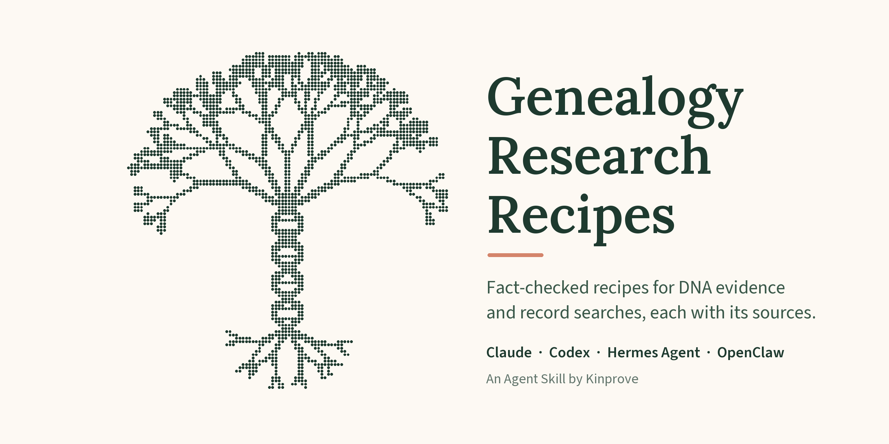

# Genealogy Research Recipes

One skill instead of many: DNA evidence and record searches across countries, archives and
testing companies, in one catalog that grows with every release. Each recipe lists its sources. The
[provenance report](https://github.com/Kinprove/genealogy-research-recipes/blob/main/PROVENANCE.md)
shows which source records have been reviewed and which are still pending.

It is one [Agent Skill](https://code.claude.com/docs/en/skills) for Claude, Codex, Hermes Agent
and OpenClaw, by [Kinprove](https://kinprove.io). It needs no Kinprove account or API key, registers
no tools or hooks, and makes no network calls of its own. To set it up, see [Install](#install).

## Recipes

- **Evidence:** [evidence, proof and working hypotheses](skills/genealogy-research-recipes/recipes/evidence-proof-judgment.md), [standards audits](skills/genealogy-research-recipes/recipes/genealogy-standards-audit.md), [AI for documents](skills/genealogy-research-recipes/recipes/ai-for-documentary-records.md), [long projects with an AI agent](skills/genealogy-research-recipes/recipes/agent-research-project.md)
- **DNA reasoning:** [unknown parentage and WATO](skills/genealogy-research-recipes/recipes/unknown-parentage-wato.md), [AI for DNA research](skills/genealogy-research-recipes/recipes/ai-for-dna-research.md), [Y-DNA and mtDNA](skills/genealogy-research-recipes/recipes/ydna-mtdna-interpretation.md), [X-DNA and phasing](skills/genealogy-research-recipes/recipes/xdna-phasing-judgment.md)
- **Measurement and retrieval controls:** [cross-vendor DNA comparisons](skills/genealogy-research-recipes/recipes/dna-comparison-controls.md), [archival images and search coverage](skills/genealogy-research-recipes/recipes/archival-image-coverage-verification.md), [corpus-seeded name searches](skills/genealogy-research-recipes/recipes/corpus-seeded-name-search.md)
- **Record sites:** [Ancestry](skills/genealogy-research-recipes/recipes/ancestry-record-search-recovery.md), [FamilySearch](skills/genealogy-research-recipes/recipes/familysearch-practical-record-workflows.md), [MyHeritage](skills/genealogy-research-recipes/recipes/myheritage-historical-record-search.md), [Newspapers.com title, issue and notice recovery](skills/genealogy-research-recipes/recipes/newspapers-com-search-recovery.md), [Geni](skills/genealogy-research-recipes/recipes/geni-practical-research-workflows.md), [U.S. census](skills/genealogy-research-recipes/recipes/us-census-practical-workflows.md), [U.S. immigration by sea, air or border](skills/genealogy-research-recipes/recipes/usa-immigration-search-recovery.md)
- **DNA sites:** [23andMe](skills/genealogy-research-recipes/recipes/23andme-match-research.md), [AncestryDNA](skills/genealogy-research-recipes/recipes/ancestry-dna-match-investigation.md), [FamilyTreeDNA exports and Group Time Tree](skills/genealogy-research-recipes/recipes/ftdna-practical-dna-workflows.md), [GEDmatch](skills/genealogy-research-recipes/recipes/gedmatch-practical-dna-workflows.md), [MyHeritage DNA](skills/genealogy-research-recipes/recipes/myheritage-dna-match-investigation.md), [DNA Painter](skills/genealogy-research-recipes/recipes/dnapainter-practical-dna-workflows.md)
- **Record recovery:** [burial evidence packets](skills/genealogy-research-recipes/recipes/burial-evidence-packet.md), [city directories](skills/genealogy-research-recipes/recipes/city-directory-observation-workflow.md), [land indexes and book series](skills/genealogy-research-recipes/recipes/land-index-book-series-recovery.md), [probate cases and reverse guardianship searches](skills/genealogy-research-recipes/recipes/probate-case-document-inventory.md), [U.S. military pension files](skills/genealogy-research-recipes/recipes/us-military-pension-file-recovery.md), [Irish Catholic parish images](skills/genealogy-research-recipes/recipes/irish-catholic-parish-image-recovery.md), [Polish originals](skills/genealogy-research-recipes/recipes/polish-index-original-record-recovery.md)
- **Tree connections:** [RootsMagic reconciliation](skills/genealogy-research-recipes/recipes/rootsmagic-tree-reconciliation-workflow.md), [WikiTree DNA tester links](skills/genealogy-research-recipes/recipes/wikitree-dna-tester-links.md), [GEDCOM export of research findings](skills/genealogy-research-recipes/recipes/gedcom-research-export.md)
- **Jewish and Russian Empire:** [name and registration changes](skills/genealogy-research-recipes/recipes/russian-empire-jewish-identity-attribution.md), [conditional naming, town and DNA clues](skills/genealogy-research-recipes/recipes/jewish-genealogy-conditional-hypotheses.md), [emigrant origins](skills/genealogy-research-recipes/recipes/russian-empire-emigrant-origin-recovery.md), [JewishGen](skills/genealogy-research-recipes/recipes/jewishgen-search-family-reconstruction.md), [Beider given names](skills/genealogy-research-recipes/recipes/beider-given-name-variants.md), [HebrewBooks](skills/genealogy-research-recipes/recipes/hebrewbooks-search-recovery.md), [rabbinic and Hasidic literature](skills/genealogy-research-recipes/recipes/rabbinic-literature-person-search.md)
- **Testimony and record episodes:** [Holocaust testimony and survivor sources](skills/genealogy-research-recipes/recipes/holocaust-testimony-source-interpretation.md), [Russian military and Soviet-repression records](skills/genealogy-research-recipes/recipes/russian-military-repression-record-episodes.md)
- **Ukrainian archives:** [Jewish named-list triage](skills/genealogy-research-recipes/recipes/jewish-archival-list-triage.md), [ELIB archival guides and volume identity](skills/genealogy-research-recipes/recipes/elib-ukrainian-archive-reference-books.md)
- **Church and civil registers:** [U.S. vital-registration coverage](skills/genealogy-research-recipes/recipes/us-vital-registration-coverage.md), [U.S. church-record custody](skills/genealogy-research-recipes/recipes/us-church-record-custody.md), [missing marriages](skills/genealogy-research-recipes/recipes/missing-marriage-jurisdiction-search.md), [early New England town books](skills/genealogy-research-recipes/recipes/early-new-england-town-records.md), [Quaker meetings](skills/genealogy-research-recipes/recipes/quaker-meeting-record-recovery.md), [Catholic parish, diocesan and status-proof holdings](skills/genealogy-research-recipes/recipes/catholic-parish-diocesan-record-recovery.md), [Catholic cross-notations](skills/genealogy-research-recipes/recipes/catholic-sacramental-cross-notations.md), [Hispanic Catholic registers](skills/genealogy-research-recipes/recipes/hispanic-catholic-register-recovery.md), [Portuguese parish and civil registers](skills/genealogy-research-recipes/recipes/portuguese-parish-civil-register-recovery.md), [French-Canadian registers](skills/genealogy-research-recipes/recipes/french-canadian-register-recovery.md), [French and Belgian civil acts](skills/genealogy-research-recipes/recipes/french-belgian-civil-act-extraction.md), [Dutch civil and church records](skills/genealogy-research-recipes/recipes/dutch-civil-church-record-recovery.md), [Amsterdam City Archives](skills/genealogy-research-recipes/recipes/amsterdam-archival-record-recovery.md), [Swedish parish registers](skills/genealogy-research-recipes/recipes/scandinavian-parish-record-recovery.md), [Scandinavian patronymic and farm names](skills/genealogy-research-recipes/recipes/scandinavian-patronymic-farm-name-record-recovery.md), [Brazilian parish and civil registries](skills/genealogy-research-recipes/recipes/brazilian-parish-civil-registry-recovery.md)
- **Country routing:** [Italy](skills/genealogy-research-recipes/recipes/italian-stato-civile-parish-record-recovery.md), [historic Hungary](skills/genealogy-research-recipes/recipes/historic-hungary-record-routing.md), [Austria and the Czech lands](skills/genealogy-research-recipes/recipes/austrian-confessional-register-routing.md), [Spain and Andorra](skills/genealogy-research-recipes/recipes/spanish-civil-parish-record-routing.md), [France by département](skills/genealogy-research-recipes/recipes/french-departmental-record-routing.md), [Australia and New Zealand](skills/genealogy-research-recipes/recipes/australia-nz-record-routing.md), [Canada by province](skills/genealogy-research-recipes/recipes/canadian-provincial-record-routing.md), [Swedish military records](skills/genealogy-research-recipes/recipes/swedish-military-record-routing.md)
- **Irish and British records:** [England and Wales GRO indexes](skills/genealogy-research-recipes/recipes/england-wales-gro-index-recovery.md), [English records beyond the parish register](skills/genealogy-research-recipes/recipes/english-nonregister-record-recovery.md), [UK censuses and the 1939 Register](skills/genealogy-research-recipes/recipes/uk-census-and-1939-register-interpretation.md), [Scottish parish and statutory registers](skills/genealogy-research-recipes/recipes/scottish-parish-statutory-record-recovery.md), [Irish civil registration](skills/genealogy-research-recipes/recipes/irish-civil-registration-jurisdiction-recovery.md), [Irish wills and deeds](skills/genealogy-research-recipes/recipes/irish-probate-and-deed-recovery.md), [Irish emigrant origins](skills/genealogy-research-recipes/recipes/irish-emigrant-origin-locality.md), [Irish valuation and tithe lists](skills/genealogy-research-recipes/recipes/irish-land-valuation-occupancy-series.md), [transported convicts](skills/genealogy-research-recipes/recipes/convict-transportation-record-chain.md), [Irish 1901 and 1911 census returns](skills/genealogy-research-recipes/recipes/irish-1901-1911-census-returns.md)
- **German records:** [German register entries](skills/genealogy-research-recipes/recipes/german-register-image-recovery.md), [German emigrant origins](skills/genealogy-research-recipes/recipes/german-emigrant-origin-sources.md), [German local censuses and residential registration](skills/genealogy-research-recipes/recipes/german-local-census-registration-recovery.md), [German military records](skills/genealogy-research-recipes/recipes/german-military-record-period-routing.md), [German official gazettes](skills/genealogy-research-recipes/recipes/german-official-gazette-notice-search.md), [German compensation files](skills/genealogy-research-recipes/recipes/german-compensation-file-recovery.md), [Nazi-era ancestry proofs](skills/genealogy-research-recipes/recipes/nazi-era-ancestry-proof-records.md)
- **Russian Empire and Soviet records:** [Orthodox metrical books](skills/genealogy-research-recipes/recipes/russian-orthodox-metrical-book-recovery.md), [Jewish metrical books and rabbinates](skills/genealogy-research-recipes/recipes/russian-empire-jewish-metrical-book-recovery.md), [revision-list households](skills/genealogy-research-recipes/recipes/russian-revision-list-household-chaining.md), [Muscovite census and settler origins](skills/genealogy-research-recipes/recipes/muscovite-census-settler-origin-recovery.md), [estate registration status](skills/genealogy-research-recipes/recipes/russian-estate-registration-status.md), [volost and town administrations](skills/genealogy-research-recipes/recipes/russian-volost-town-administration-records.md), [Old Believers](skills/genealogy-research-recipes/recipes/old-believer-sectarian-record-recovery.md), [Orthodox clergy](skills/genealogy-research-recipes/recipes/orthodox-clergy-record-recovery.md), [imperial service lists](skills/genealogy-research-recipes/recipes/russian-imperial-service-record-recovery.md), [schools and universities](skills/genealogy-research-recipes/recipes/school-university-record-recovery.md), [Soviet personal files](skills/genealogy-research-recipes/recipes/soviet-personal-file-recovery.md), [Bessarabia and Moldova by period and district](skills/genealogy-research-recipes/recipes/bessarabia-moldova-record-routing.md), [Galicia and Bukovina by confession and custodian](skills/genealogy-research-recipes/recipes/galicia-bukovina-habsburg-record-routing.md), [the 1944 Chechen and Ingush deportation](skills/genealogy-research-recipes/recipes/chechen-ingush-1944-deportation-records.md), [Orthodox confession lists](skills/genealogy-research-recipes/recipes/russian-orthodox-confession-list-reading.md), [auditing confession-list and revision-list transcriptions](skills/genealogy-research-recipes/recipes/russian-household-list-transcription-audit.md)
- **Censuses, tax, land and property:** [Canadian censuses](skills/genealogy-research-recipes/recipes/canadian-census-interpretation.md), [tax rolls](skills/genealogy-research-recipes/recipes/tax-roll-observation-workflow.md), [deed content](skills/genealogy-research-recipes/recipes/deed-content-relationship-clues.md), [U.S. federal land-entry files](skills/genealogy-research-recipes/recipes/us-federal-land-entry-file-recovery.md), [livestock marks and brands](skills/genealogy-research-recipes/recipes/marks-and-brands-record-recovery.md)
- **Courts, legislatures, prisons and institutions:** [U.S. court case files](skills/genealogy-research-recipes/recipes/court-case-file-recovery.md), [U.S. federal court case files](skills/genealogy-research-recipes/recipes/us-federal-court-case-file-recovery.md), [U.S. criminal courts and prisons, with England/Wales and Swedish routes](skills/genealogy-research-recipes/recipes/criminal-court-prison-record-recovery.md), [state legislative private acts](skills/genealogy-research-recipes/recipes/state-legislative-private-act-petitions.md), [births outside marriage](skills/genealogy-research-recipes/recipes/illegitimacy-record-recovery.md), [asylum and state-hospital patients](skills/genealogy-research-recipes/recipes/institutional-patient-record-recovery.md), [U.S. records under the law of their date](skills/genealogy-research-recipes/recipes/us-period-law-record-reading.md)
- **U.S. military service:** [routing by service type](skills/genealogy-research-recipes/recipes/us-military-service-type-record-routing.md), [Civil War service episodes](skills/genealogy-research-recipes/recipes/us-civil-war-service-record-episodes.md), [20th-century service reconstruction and WWI family packets](skills/genealogy-research-recipes/recipes/us-20th-century-military-service-reconstruction.md)
- **Migration and origins:** [immigrant congregations](skills/genealogy-research-recipes/recipes/immigrant-congregation-origin-records.md), [surname-distribution leads](skills/genealogy-research-recipes/recipes/surname-distribution-locality-leads.md), [African American families across 1870](skills/genealogy-research-recipes/recipes/us-freedpeople-record-recovery.md), [Chinese lineage and jiapu](skills/genealogy-research-recipes/recipes/chinese-lineage-jiapu-records.md), [Japanese koseki and honseki](skills/genealogy-research-recipes/recipes/japanese-koseki-honseki-recovery.md), [British colonial slave registers](skills/genealogy-research-recipes/recipes/british-colonial-slave-registers.md)
- **Places, maps, libraries and manuscripts:** [historical place names](skills/genealogy-research-recipes/recipes/historical-place-name-resolution.md), [historical maps and possible originating cases](skills/genealogy-research-recipes/recipes/historical-map-record-recovery.md), [published books](skills/genealogy-research-recipes/recipes/published-book-catalogue-and-full-text-discovery.md), [periodical indexes](skills/genealogy-research-recipes/recipes/periodical-index-search-retrieval.md), [manuscripts, ledgers and fraternal claim folders](skills/genealogy-research-recipes/recipes/manuscript-collection-recovery.md), [uncatalogued local holdings](skills/genealogy-research-recipes/recipes/local-repository-uncatalogued-holdings.md)
- **Family papers, photographs and oral history:** [family collection intake and capture](skills/genealogy-research-recipes/recipes/family-collection-intake-and-capture.md), [family photographs](skills/genealogy-research-recipes/recipes/family-photograph-attribution-and-dating.md), [family papers and Bible registers](skills/genealogy-research-recipes/recipes/family-papers-and-bible-register-dating.md), [family interviews and oral tradition](skills/genealogy-research-recipes/recipes/family-interviews-and-oral-tradition.md), [repository photograph collections](skills/genealogy-research-recipes/recipes/repository-photograph-collection-search.md)
- **DNA workflows and research planning:** [admixture run scope](skills/genealogy-research-recipes/recipes/admixture-model-run-scope.md), [DNA match outreach](skills/genealogy-research-recipes/recipes/dna-match-outreach-staging.md), [descendancy gap worklists](skills/genealogy-research-recipes/recipes/descendancy-gap-worklist.md), [ethnicity-estimate versions](skills/genealogy-research-recipes/recipes/ethnicity-estimate-version-comparison.md)

Each recipe's sources are in [`sources/`](skills/genealogy-research-recipes/sources/).

## Evaluation

CI checks every change offline: each recipe is reachable from the skill, every link resolves,
and the safeguards that the test cases rely on still appear in the recipes. A second suite gives
an agent synthetic research questions and checks that it opens the right recipes and follows
their safeguards. Commands, rules and recorded results: [docs/evaluation.md](https://github.com/Kinprove/genealogy-research-recipes/blob/main/docs/evaluation.md).

## Install

<!-- platform:claude:start -->
**Claude Code:**

```text
/plugin marketplace add Kinprove/genealogy-research-recipes
/plugin install genealogy-research-recipes@kinprove
```

Update with `claude plugin update genealogy-research-recipes@kinprove`, or turn on
**Enable auto-update** for the `kinprove` marketplace under `/plugin` → **Marketplaces**.

**Claude.ai and the Claude desktop app:** **Customize → Plugins → Add → Add marketplace**, enter
`Kinprove/genealogy-research-recipes`, then add `genealogy-research-recipes`. Update with
**Check for updates** on the `kinprove` marketplace, or turn on **Sync automatically**.

This repository is its own `kinprove` marketplace
([`.claude-plugin/marketplace.json`](https://github.com/Kinprove/genealogy-research-recipes/blob/main/.claude-plugin/marketplace.json)),
not an entry in an Anthropic-curated directory.
<!-- platform:claude:end -->

<!-- platform:codex:start -->
**Codex:**

```sh
codex plugin marketplace add Kinprove/genealogy-research-recipes
codex plugin add genealogy-research-recipes@kinprove
```

Update with `codex plugin marketplace upgrade kinprove`, then run the `codex plugin add` command
again.
<!-- platform:codex:end -->

<!-- platform:hermes:start -->
**Hermes Agent:**

```sh
hermes plugins install genealogy-research-recipes --no-enable
hermes plugins enable genealogy-research-recipes
```

Load it with `skill_view(name="genealogy-research-recipes:genealogy-research-recipes")`; a recipe
loads with the extra argument `file_path="recipes/<name>.md"`. Update with
`hermes plugins update genealogy-research-recipes`.

The [Hermes plugin catalog](https://hermes-agent.nousresearch.com/docs/plugins) pins a reviewed
commit, so it can lag behind the latest release. For the latest `main`, install from the Git
repository instead:

```sh
hermes plugins install Kinprove/genealogy-research-recipes --no-enable
hermes plugins enable genealogy-research-recipes
```
<!-- platform:hermes:end -->

<!-- platform:openclaw:start -->
**OpenClaw:**

```sh
openclaw plugins install git:github.com/Kinprove/genealogy-research-recipes
```

Restart the Gateway after installing. Update with
`openclaw plugins update genealogy-research-recipes`. Published releases are also on
[ClawHub](https://clawhub.ai) as `clawhub:@kinprove/genealogy-research-recipes`. ClawHub
publication is separate from the GitHub install; check the publisher, version and source commit on
ClawHub before installing from it.
<!-- platform:openclaw:end -->

The skill states its release date. When an installed copy is more than a week old, the agent
mentions once per conversation that a newer version may exist and how to update.

## Privacy

The plugin collects, stores and sends nothing by itself. It is text, with an optional script
(`scripts/lookup_beider_name.py`) that, when bundled, looks up name variants offline on your machine.
An install from this Git repository also copies its development files: tests, the evaluation
harness and CI tooling. The plugin never runs them. The ClawHub package and the release
distributions leave them out.
Some recipes tell the agent to search public record sites, such as FamilySearch or national
archives, for the names, places and dates you give it. Those searches run through your agent's
own web tools, during the research you ask it to do.

Before an outbound step, answer the skill’s privacy gate: whose data leaves, what leaves,
where it goes and who has authorized it. Kinprove’s privacy policy: <https://kinprove.io/privacy>.

<details>
<summary>Recipe capabilities and privacy gates</summary>

<!-- recipe-capabilities:start -->
These are described actions, not permissions or tools that the plugin runs. An empty cell means
no declared action of that kind. The privacy gate also applies to unlisted outbound steps.

| Recipe | Browse | Local script | Extensions | Data transfer | Contact | Privacy gate |
| --- | --- | --- | --- | --- | --- | --- |
| [23andme-match-research](skills/genealogy-research-recipes/recipes/23andme-match-research.md) | 23andme, dna-painter | — | Genea browser extension (optional) | export, link, third-party-tool, upload | contact | required |
| [admixture-model-run-scope](skills/genealogy-research-recipes/recipes/admixture-model-run-scope.md) | — | — | — | — | — | — |
| [agent-research-project](skills/genealogy-research-recipes/recipes/agent-research-project.md) | — | — | — | publish, third-party-tool | — | required |
| [ai-for-dna-research](skills/genealogy-research-recipes/recipes/ai-for-dna-research.md) | — | — | — | export, third-party-tool | contact | required |
| [ai-for-documentary-records](skills/genealogy-research-recipes/recipes/ai-for-documentary-records.md) | — | generated plotting script | — | export, third-party-tool | — | required |
| [amsterdam-archival-record-recovery](skills/genealogy-research-recipes/recipes/amsterdam-archival-record-recovery.md) | record catalogues and original images | — | — | — | — | — |
| [ancestry-dna-match-investigation](skills/genealogy-research-recipes/recipes/ancestry-dna-match-investigation.md) | ancestrydna | — | browser extension view comparison (optional) | link | contact | required |
| [ancestry-record-search-recovery](skills/genealogy-research-recipes/recipes/ancestry-record-search-recovery.md) | ancestry | — | — | — | — | — |
| [archival-image-coverage-verification](skills/genealogy-research-recipes/recipes/archival-image-coverage-verification.md) | — | — | — | — | — | — |
| [australia-nz-record-routing](skills/genealogy-research-recipes/recipes/australia-nz-record-routing.md) | record catalogues and original images | — | — | — | — | — |
| [austrian-confessional-register-routing](skills/genealogy-research-recipes/recipes/austrian-confessional-register-routing.md) | record catalogues and original images | — | — | request | — | required |
| [beider-given-name-variants](skills/genealogy-research-recipes/recipes/beider-given-name-variants.md) | — | scripts/lookup_beider_name.py | — | — | — | — |
| [bessarabia-moldova-record-routing](skills/genealogy-research-recipes/recipes/bessarabia-moldova-record-routing.md) | record catalogues and original images | — | — | request | — | required |
| [brazilian-parish-civil-registry-recovery](skills/genealogy-research-recipes/recipes/brazilian-parish-civil-registry-recovery.md) | record catalogues and original images | — | — | — | — | — |
| [british-colonial-slave-registers](skills/genealogy-research-recipes/recipes/british-colonial-slave-registers.md) | record catalogues and original images | — | — | — | — | — |
| [burial-evidence-packet](skills/genealogy-research-recipes/recipes/burial-evidence-packet.md) | record catalogues and original images | — | — | — | contact | required |
| [canadian-census-interpretation](skills/genealogy-research-recipes/recipes/canadian-census-interpretation.md) | record catalogues and original images | — | — | — | — | — |
| [canadian-provincial-record-routing](skills/genealogy-research-recipes/recipes/canadian-provincial-record-routing.md) | record catalogues and original images | — | — | — | — | — |
| [catholic-parish-diocesan-record-recovery](skills/genealogy-research-recipes/recipes/catholic-parish-diocesan-record-recovery.md) | record catalogues and original images | — | — | — | — | — |
| [catholic-sacramental-cross-notations](skills/genealogy-research-recipes/recipes/catholic-sacramental-cross-notations.md) | record catalogues and original images | — | — | — | — | — |
| [chechen-ingush-1944-deportation-records](skills/genealogy-research-recipes/recipes/chechen-ingush-1944-deportation-records.md) | record catalogues and original images | — | — | request | — | required |
| [chinese-lineage-jiapu-records](skills/genealogy-research-recipes/recipes/chinese-lineage-jiapu-records.md) | record catalogues and original images | — | — | request | — | required |
| [city-directory-observation-workflow](skills/genealogy-research-recipes/recipes/city-directory-observation-workflow.md) | record catalogues and original images | — | — | — | — | — |
| [convict-transportation-record-chain](skills/genealogy-research-recipes/recipes/convict-transportation-record-chain.md) | record catalogues and original images | — | — | — | — | — |
| [corpus-seeded-name-search](skills/genealogy-research-recipes/recipes/corpus-seeded-name-search.md) | — | — | — | — | — | — |
| [court-case-file-recovery](skills/genealogy-research-recipes/recipes/court-case-file-recovery.md) | record catalogues and original images | — | — | request | — | required |
| [criminal-court-prison-record-recovery](skills/genealogy-research-recipes/recipes/criminal-court-prison-record-recovery.md) | record catalogues and original images | — | — | request, third-party-tool | — | required |
| [deed-content-relationship-clues](skills/genealogy-research-recipes/recipes/deed-content-relationship-clues.md) | record catalogues and original images | — | — | — | — | — |
| [descendancy-gap-worklist](skills/genealogy-research-recipes/recipes/descendancy-gap-worklist.md) | — | — | — | export | — | required |
| [dna-comparison-controls](skills/genealogy-research-recipes/recipes/dna-comparison-controls.md) | — | — | — | export, third-party-tool, upload | — | required |
| [dna-match-outreach-staging](skills/genealogy-research-recipes/recipes/dna-match-outreach-staging.md) | — | — | — | export, publish | contact | required |
| [dnapainter-practical-dna-workflows](skills/genealogy-research-recipes/recipes/dnapainter-practical-dna-workflows.md) | dna-painter | — | — | export, link, publish, third-party-tool, upload | — | required |
| [dutch-civil-church-record-recovery](skills/genealogy-research-recipes/recipes/dutch-civil-church-record-recovery.md) | record catalogues and original images | — | — | — | — | — |
| [early-new-england-town-records](skills/genealogy-research-recipes/recipes/early-new-england-town-records.md) | record catalogues and original images | — | — | — | — | — |
| [elib-ukrainian-archive-reference-books](skills/genealogy-research-recipes/recipes/elib-ukrainian-archive-reference-books.md) | elib.nlu.org.ua | — | — | — | — | — |
| [england-wales-gro-index-recovery](skills/genealogy-research-recipes/recipes/england-wales-gro-index-recovery.md) | record catalogues and original images | — | — | — | — | — |
| [english-nonregister-record-recovery](skills/genealogy-research-recipes/recipes/english-nonregister-record-recovery.md) | record catalogues and original images | — | — | — | — | — |
| [ethnicity-estimate-version-comparison](skills/genealogy-research-recipes/recipes/ethnicity-estimate-version-comparison.md) | — | — | — | export | — | required |
| [evidence-proof-judgment](skills/genealogy-research-recipes/recipes/evidence-proof-judgment.md) | — | — | — | — | — | — |
| [family-collection-intake-and-capture](skills/genealogy-research-recipes/recipes/family-collection-intake-and-capture.md) | record catalogues and original images | — | — | — | contact | required |
| [family-interviews-and-oral-tradition](skills/genealogy-research-recipes/recipes/family-interviews-and-oral-tradition.md) | record catalogues and original images | — | — | export | — | required |
| [family-papers-and-bible-register-dating](skills/genealogy-research-recipes/recipes/family-papers-and-bible-register-dating.md) | record catalogues and original images | — | — | third-party-tool | — | required |
| [family-photograph-attribution-and-dating](skills/genealogy-research-recipes/recipes/family-photograph-attribution-and-dating.md) | record catalogues and original images | — | — | publish, third-party-tool | contact | required |
| [familysearch-practical-record-workflows](skills/genealogy-research-recipes/recipes/familysearch-practical-record-workflows.md) | familysearch | — | — | export, publish, upload | — | required |
| [french-belgian-civil-act-extraction](skills/genealogy-research-recipes/recipes/french-belgian-civil-act-extraction.md) | record catalogues and original images | — | — | — | — | — |
| [french-canadian-register-recovery](skills/genealogy-research-recipes/recipes/french-canadian-register-recovery.md) | record catalogues and original images | — | — | — | — | — |
| [french-departmental-record-routing](skills/genealogy-research-recipes/recipes/french-departmental-record-routing.md) | record catalogues and original images | — | — | — | — | — |
| [ftdna-practical-dna-workflows](skills/genealogy-research-recipes/recipes/ftdna-practical-dna-workflows.md) | familytreedna | — | — | export, link, publish | — | required |
| [galicia-bukovina-habsburg-record-routing](skills/genealogy-research-recipes/recipes/galicia-bukovina-habsburg-record-routing.md) | record catalogues and original images | — | — | request | — | required |
| [gedcom-research-export](skills/genealogy-research-recipes/recipes/gedcom-research-export.md) | — | — | — | export, upload | — | required |
| [gedmatch-practical-dna-workflows](skills/genealogy-research-recipes/recipes/gedmatch-practical-dna-workflows.md) | gedmatch | — | — | export, third-party-tool, upload | — | required |
| [genealogy-standards-audit](skills/genealogy-research-recipes/recipes/genealogy-standards-audit.md) | — | — | — | — | — | — |
| [geni-practical-research-workflows](skills/genealogy-research-recipes/recipes/geni-practical-research-workflows.md) | geni | — | — | export, publish, upload | contact | required |
| [german-compensation-file-recovery](skills/genealogy-research-recipes/recipes/german-compensation-file-recovery.md) | record catalogues and original images | — | — | request | — | required |
| [german-emigrant-origin-sources](skills/genealogy-research-recipes/recipes/german-emigrant-origin-sources.md) | record catalogues and original images | — | — | — | — | — |
| [german-local-census-registration-recovery](skills/genealogy-research-recipes/recipes/german-local-census-registration-recovery.md) | record catalogues and original images | — | — | request | — | required |
| [german-military-record-period-routing](skills/genealogy-research-recipes/recipes/german-military-record-period-routing.md) | record catalogues and original images | — | — | — | — | — |
| [german-official-gazette-notice-search](skills/genealogy-research-recipes/recipes/german-official-gazette-notice-search.md) | record catalogues and original images | — | — | — | — | — |
| [german-register-image-recovery](skills/genealogy-research-recipes/recipes/german-register-image-recovery.md) | record catalogues and original images | — | — | — | — | — |
| [hebrewbooks-search-recovery](skills/genealogy-research-recipes/recipes/hebrewbooks-search-recovery.md) | hebrewbooks | — | — | — | — | — |
| [hispanic-catholic-register-recovery](skills/genealogy-research-recipes/recipes/hispanic-catholic-register-recovery.md) | record catalogues and original images | — | — | — | — | — |
| [historic-hungary-record-routing](skills/genealogy-research-recipes/recipes/historic-hungary-record-routing.md) | record catalogues and original images | — | — | — | — | — |
| [historical-map-record-recovery](skills/genealogy-research-recipes/recipes/historical-map-record-recovery.md) | record catalogues and original images | — | — | — | — | — |
| [historical-place-name-resolution](skills/genealogy-research-recipes/recipes/historical-place-name-resolution.md) | record catalogues and original images | — | — | — | — | — |
| [holocaust-testimony-source-interpretation](skills/genealogy-research-recipes/recipes/holocaust-testimony-source-interpretation.md) | record catalogues and original images | — | — | request | contact | required |
| [illegitimacy-record-recovery](skills/genealogy-research-recipes/recipes/illegitimacy-record-recovery.md) | record catalogues and original images | — | — | request | — | required |
| [immigrant-congregation-origin-records](skills/genealogy-research-recipes/recipes/immigrant-congregation-origin-records.md) | record catalogues and original images | — | — | — | — | — |
| [institutional-patient-record-recovery](skills/genealogy-research-recipes/recipes/institutional-patient-record-recovery.md) | record catalogues and original images | — | — | request | — | required |
| [irish-1901-1911-census-returns](skills/genealogy-research-recipes/recipes/irish-1901-1911-census-returns.md) | record catalogues and original images | — | — | — | — | — |
| [irish-catholic-parish-image-recovery](skills/genealogy-research-recipes/recipes/irish-catholic-parish-image-recovery.md) | record catalogues and original images | — | — | request | — | required |
| [irish-civil-registration-jurisdiction-recovery](skills/genealogy-research-recipes/recipes/irish-civil-registration-jurisdiction-recovery.md) | record catalogues and original images | — | — | request | — | required |
| [irish-emigrant-origin-locality](skills/genealogy-research-recipes/recipes/irish-emigrant-origin-locality.md) | record catalogues and original images | — | — | — | — | — |
| [irish-land-valuation-occupancy-series](skills/genealogy-research-recipes/recipes/irish-land-valuation-occupancy-series.md) | record catalogues and original images | — | — | — | — | — |
| [irish-probate-and-deed-recovery](skills/genealogy-research-recipes/recipes/irish-probate-and-deed-recovery.md) | record catalogues and original images | — | — | — | — | — |
| [italian-stato-civile-parish-record-recovery](skills/genealogy-research-recipes/recipes/italian-stato-civile-parish-record-recovery.md) | record catalogues and original images | — | — | — | — | — |
| [japanese-koseki-honseki-recovery](skills/genealogy-research-recipes/recipes/japanese-koseki-honseki-recovery.md) | record catalogues and original images | — | — | request | — | required |
| [jewish-archival-list-triage](skills/genealogy-research-recipes/recipes/jewish-archival-list-triage.md) | record catalogues and original images | — | — | — | — | — |
| [jewish-genealogy-conditional-hypotheses](skills/genealogy-research-recipes/recipes/jewish-genealogy-conditional-hypotheses.md) | — | — | — | — | — | — |
| [jewishgen-search-family-reconstruction](skills/genealogy-research-recipes/recipes/jewishgen-search-family-reconstruction.md) | jewishgen | — | — | — | contact | required |
| [land-index-book-series-recovery](skills/genealogy-research-recipes/recipes/land-index-book-series-recovery.md) | record catalogues and original images | — | — | — | — | — |
| [local-repository-uncatalogued-holdings](skills/genealogy-research-recipes/recipes/local-repository-uncatalogued-holdings.md) | record catalogues and original images | — | — | — | — | — |
| [manuscript-collection-recovery](skills/genealogy-research-recipes/recipes/manuscript-collection-recovery.md) | record catalogues and original images | — | — | — | — | — |
| [marks-and-brands-record-recovery](skills/genealogy-research-recipes/recipes/marks-and-brands-record-recovery.md) | record catalogues and original images | — | — | — | — | — |
| [missing-marriage-jurisdiction-search](skills/genealogy-research-recipes/recipes/missing-marriage-jurisdiction-search.md) | record catalogues and original images | — | — | request | — | required |
| [muscovite-census-settler-origin-recovery](skills/genealogy-research-recipes/recipes/muscovite-census-settler-origin-recovery.md) | record catalogues and original images | — | — | — | — | — |
| [myheritage-dna-match-investigation](skills/genealogy-research-recipes/recipes/myheritage-dna-match-investigation.md) | myheritage | — | — | export, link, publish | contact | required |
| [myheritage-historical-record-search](skills/genealogy-research-recipes/recipes/myheritage-historical-record-search.md) | myheritage | — | — | — | — | — |
| [nazi-era-ancestry-proof-records](skills/genealogy-research-recipes/recipes/nazi-era-ancestry-proof-records.md) | record catalogues and original images | — | — | request | — | required |
| [newspapers-com-search-recovery](skills/genealogy-research-recipes/recipes/newspapers-com-search-recovery.md) | newspapers.com | — | — | — | — | — |
| [old-believer-sectarian-record-recovery](skills/genealogy-research-recipes/recipes/old-believer-sectarian-record-recovery.md) | record catalogues and original images | — | — | — | — | — |
| [orthodox-clergy-record-recovery](skills/genealogy-research-recipes/recipes/orthodox-clergy-record-recovery.md) | record catalogues and original images | — | — | — | — | — |
| [periodical-index-search-retrieval](skills/genealogy-research-recipes/recipes/periodical-index-search-retrieval.md) | record catalogues and original images | — | — | — | — | — |
| [polish-index-original-record-recovery](skills/genealogy-research-recipes/recipes/polish-index-original-record-recovery.md) | record catalogues and original images | — | — | request | — | required |
| [portuguese-parish-civil-register-recovery](skills/genealogy-research-recipes/recipes/portuguese-parish-civil-register-recovery.md) | record catalogues and original images | — | — | — | — | — |
| [probate-case-document-inventory](skills/genealogy-research-recipes/recipes/probate-case-document-inventory.md) | record catalogues and original images | — | — | — | — | — |
| [published-book-catalogue-and-full-text-discovery](skills/genealogy-research-recipes/recipes/published-book-catalogue-and-full-text-discovery.md) | record catalogues and original images | — | — | — | — | — |
| [quaker-meeting-record-recovery](skills/genealogy-research-recipes/recipes/quaker-meeting-record-recovery.md) | record catalogues and original images | — | — | — | — | — |
| [rabbinic-literature-person-search](skills/genealogy-research-recipes/recipes/rabbinic-literature-person-search.md) | record catalogues and original images | — | — | — | — | — |
| [repository-photograph-collection-search](skills/genealogy-research-recipes/recipes/repository-photograph-collection-search.md) | record catalogues and original images | — | — | publish, third-party-tool | contact | required |
| [research-documentation](skills/genealogy-research-recipes/recipes/research-documentation.md) | — | — | — | publish | — | required |
| [rootsmagic-tree-reconciliation-workflow](skills/genealogy-research-recipes/recipes/rootsmagic-tree-reconciliation-workflow.md) | rootsmagic, ancestry, familysearch | — | — | export, link, upload | — | required |
| [russian-empire-emigrant-origin-recovery](skills/genealogy-research-recipes/recipes/russian-empire-emigrant-origin-recovery.md) | record catalogues and original images | — | — | publish | — | required |
| [russian-empire-jewish-identity-attribution](skills/genealogy-research-recipes/recipes/russian-empire-jewish-identity-attribution.md) | record catalogues and original images | — | — | — | contact | required |
| [russian-empire-jewish-metrical-book-recovery](skills/genealogy-research-recipes/recipes/russian-empire-jewish-metrical-book-recovery.md) | record catalogues and original images | — | — | — | — | — |
| [russian-estate-registration-status](skills/genealogy-research-recipes/recipes/russian-estate-registration-status.md) | record catalogues and original images | — | — | — | — | — |
| [russian-household-list-transcription-audit](skills/genealogy-research-recipes/recipes/russian-household-list-transcription-audit.md) | record catalogues and original images | — | — | — | — | — |
| [russian-imperial-service-record-recovery](skills/genealogy-research-recipes/recipes/russian-imperial-service-record-recovery.md) | record catalogues and original images | — | — | — | — | — |
| [russian-military-repression-record-episodes](skills/genealogy-research-recipes/recipes/russian-military-repression-record-episodes.md) | record catalogues and original images | — | — | request | — | required |
| [russian-orthodox-confession-list-reading](skills/genealogy-research-recipes/recipes/russian-orthodox-confession-list-reading.md) | record catalogues and original images | — | — | — | — | — |
| [russian-orthodox-metrical-book-recovery](skills/genealogy-research-recipes/recipes/russian-orthodox-metrical-book-recovery.md) | record catalogues and original images | — | — | — | — | — |
| [russian-revision-list-household-chaining](skills/genealogy-research-recipes/recipes/russian-revision-list-household-chaining.md) | record catalogues and original images | — | — | — | — | — |
| [russian-volost-town-administration-records](skills/genealogy-research-recipes/recipes/russian-volost-town-administration-records.md) | record catalogues and original images | — | — | — | — | — |
| [scandinavian-parish-record-recovery](skills/genealogy-research-recipes/recipes/scandinavian-parish-record-recovery.md) | record catalogues and original images | — | — | — | — | — |
| [scandinavian-patronymic-farm-name-record-recovery](skills/genealogy-research-recipes/recipes/scandinavian-patronymic-farm-name-record-recovery.md) | record catalogues and original images | — | — | — | — | — |
| [school-university-record-recovery](skills/genealogy-research-recipes/recipes/school-university-record-recovery.md) | record catalogues and original images | — | — | — | — | — |
| [scottish-parish-statutory-record-recovery](skills/genealogy-research-recipes/recipes/scottish-parish-statutory-record-recovery.md) | record catalogues and original images | — | — | request | — | required |
| [source-citation](skills/genealogy-research-recipes/recipes/source-citation.md) | — | — | — | — | — | — |
| [soviet-personal-file-recovery](skills/genealogy-research-recipes/recipes/soviet-personal-file-recovery.md) | record catalogues and original images | — | — | request | — | required |
| [spanish-civil-parish-record-routing](skills/genealogy-research-recipes/recipes/spanish-civil-parish-record-routing.md) | record catalogues and original images | — | — | — | — | — |
| [state-legislative-private-act-petitions](skills/genealogy-research-recipes/recipes/state-legislative-private-act-petitions.md) | record catalogues and original images | — | — | — | — | — |
| [surname-distribution-locality-leads](skills/genealogy-research-recipes/recipes/surname-distribution-locality-leads.md) | record catalogues and original images | — | — | — | — | — |
| [swedish-military-record-routing](skills/genealogy-research-recipes/recipes/swedish-military-record-routing.md) | record catalogues and original images | — | — | — | — | — |
| [tax-roll-observation-workflow](skills/genealogy-research-recipes/recipes/tax-roll-observation-workflow.md) | record catalogues and original images | — | — | — | — | — |
| [uk-census-and-1939-register-interpretation](skills/genealogy-research-recipes/recipes/uk-census-and-1939-register-interpretation.md) | record catalogues and original images | — | — | — | — | — |
| [unknown-parentage-wato](skills/genealogy-research-recipes/recipes/unknown-parentage-wato.md) | — | — | — | link, publish, third-party-tool, upload | contact | required |
| [us-20th-century-military-service-reconstruction](skills/genealogy-research-recipes/recipes/us-20th-century-military-service-reconstruction.md) | record catalogues and original images | — | — | request | — | required |
| [us-census-practical-workflows](skills/genealogy-research-recipes/recipes/us-census-practical-workflows.md) | record catalogues and original images | — | — | — | — | — |
| [us-church-record-custody](skills/genealogy-research-recipes/recipes/us-church-record-custody.md) | record catalogues and original images | — | — | — | — | — |
| [us-civil-war-service-record-episodes](skills/genealogy-research-recipes/recipes/us-civil-war-service-record-episodes.md) | record catalogues and original images | — | — | — | — | — |
| [us-federal-court-case-file-recovery](skills/genealogy-research-recipes/recipes/us-federal-court-case-file-recovery.md) | record catalogues and original images | — | — | — | — | — |
| [us-federal-land-entry-file-recovery](skills/genealogy-research-recipes/recipes/us-federal-land-entry-file-recovery.md) | record catalogues and original images | — | — | — | — | — |
| [us-freedpeople-record-recovery](skills/genealogy-research-recipes/recipes/us-freedpeople-record-recovery.md) | record catalogues and original images | — | — | — | — | — |
| [us-military-pension-file-recovery](skills/genealogy-research-recipes/recipes/us-military-pension-file-recovery.md) | record catalogues and original images | — | — | — | — | — |
| [us-military-service-type-record-routing](skills/genealogy-research-recipes/recipes/us-military-service-type-record-routing.md) | record catalogues and original images | — | — | — | — | — |
| [us-period-law-record-reading](skills/genealogy-research-recipes/recipes/us-period-law-record-reading.md) | record catalogues and original images | — | — | — | — | — |
| [us-vital-registration-coverage](skills/genealogy-research-recipes/recipes/us-vital-registration-coverage.md) | record catalogues and original images | — | — | — | — | — |
| [usa-immigration-search-recovery](skills/genealogy-research-recipes/recipes/usa-immigration-search-recovery.md) | record catalogues and original images | — | — | request | — | required |
| [wikitree-dna-tester-links](skills/genealogy-research-recipes/recipes/wikitree-dna-tester-links.md) | wikitree, familytreedna | — | — | link | — | required |
| [xdna-phasing-judgment](skills/genealogy-research-recipes/recipes/xdna-phasing-judgment.md) | — | — | — | third-party-tool | — | required |
| [ydna-mtdna-interpretation](skills/genealogy-research-recipes/recipes/ydna-mtdna-interpretation.md) | — | — | — | third-party-tool, upload | contact | required |
<!-- recipe-capabilities:end -->

</details>

## Kinprove MCP (optional)

Add `https://api.kinprove.io/mcp/v1` as an MCP connector so the agent can read your own Kinprove
matches and projects.

## Contributing and reporting problems

For corrections and installation failures, use the [issue templates](https://github.com/Kinprove/genealogy-research-recipes/issues/new/choose).
Report security or privacy problems privately as described in [SECURITY.md](https://github.com/Kinprove/genealogy-research-recipes/blob/main/SECURITY.md).
Local checks and contribution guidance are in [CONTRIBUTING.md](https://github.com/Kinprove/genealogy-research-recipes/blob/main/CONTRIBUTING.md).

## License

[FSL-1.1-MIT](LICENSE), © 2026 Kinprove. Each version becomes MIT two years after its release; the
dates are in the [release history](skills/genealogy-research-recipes/CHANGELOG.md). Third-party
material quoted or adapted in the recipes, and the Beider name data, are not licensed by Kinprove:
see [NOTICE](https://github.com/Kinprove/genealogy-research-recipes/blob/main/NOTICE).

How Kinprove reads the licence (the [LICENSE](LICENSE) text governs). Allowed:

- distributing the unmodified package, with LICENSE and NOTICE, through plugin marketplaces and
  catalogs;
- running the recipes in an AI assistant, or offering them as an installable plugin in one,
  including on paid plans;
- personal, educational and research use;
- professional genealogists using the recipes in their research for clients.

A commercial genealogy or DNA product or service that builds the recipes into what it offers its
own customers, for example its own research assistant, needs a licence from Kinprove until that
version becomes MIT. Licence requests, questions, and rights holders' requests to rewrite or remove
a passage: <hola@kinprove.io>.

Release and publishing notes, including the locked `ci-tools` install:
[MAINTAINERS.md](https://github.com/Kinprove/genealogy-research-recipes/blob/main/MAINTAINERS.md).
